# obdeect versus sim_telarray, 2026-11-13

<!-- notes:intro -->
Run: `obdeect-validate run --suite suites/full.json --environment environments/workspace.json`
in the simtools-prod based container; obdeect `0.8.1.dev27+g7544a7978` plus the
trace-stream index fix, sim_telarray v2025-11-30-rc (released binary), models 6.0.2
(optics) and 7.0.0 (chain). `chain.atmosphere-substitution` is from a rerun after
staging its CORSIKA log; the first run was ERROR (missing input). Performance is a
separate report-only run.

Four failures are source timing or impact-point conventions, one is the EventIO block order
for light-source streams. Every photon count, direction and camera p.e. comparison passes.
<!-- /notes -->

**Result: 5 FAIL, 14 PASS, 1 REPORT ONLY** (suite `full`, status ERROR). Each case below shows what is compared, its headline numbers and figures; all metrics are in the case's `metrics.json`, limits and settings in `details.json`.

| Step | Case | Headline | Verdict |
|---|---|---|---|
| 1. Photon stream format | [LED stream → sim_telarray EventIO, strict reader](#stream-led-eventio) | photons 60 / 0 | FAIL |
| 1. Photon stream format | [CORSIKA → stream → sim_telarray](#stream-corsika-roundtrip) | p.e. +0.07% ± 0.09%, 0 trigger mismatches | PASS |
| 2. Atmosphere (propagation) | [Extinction vs analytic Beer–Lambert](#propagation-extinction-analytic) | largest transmission error 0.0e+00 | PASS |
| 2. Atmosphere (propagation) | [Extinction vs sim_telarray tables](#propagation-extinction-simtel-table) | largest error 4.5e-08 | PASS |
| 2. Atmosphere (propagation) | [Refraction and timing vs CORSIKA atmo](#propagation-atmosphere-corsika) | displacement 4.4e-04 m, time 1.6e-03 ns | PASS |
| 3. Light sources | [LED vs pixled](#sources-led-reference) | photons 60 / 60 | PASS |
| 3. Light sources | [Flasher on the dish vs ff-1m](#sources-flasher-dish) | photons 0.9987 ± 0.0007, camera p.e. 1.0013 ± 0.0019 | PASS |
| 3. Light sources | [Flasher via secondary mirror vs ff-gct](#sources-flasher-secondary) | photons 1.0001 ± 0.0022, time +0.123 ns | FAIL |
| 3. Light sources | [Point source vs xyzls](#sources-point-source) | accepted photons 0.994 ± 0.012, time -0.696 ns, camera p.e. 0.996 ± 0.006 | FAIL |
| 3. Light sources | [Beam scan vs xyls](#sources-beam-scan) | photons 1.000 ± 0.006 | PASS |
| 3. Light sources | [Laser beam geometry vs ls-beam](#sources-laser-beam) | path 131.60 vs 131.65 m | PASS |
| 3. Light sources | [Night sky vs analytic and nsbls](#sources-night-sky) | rate error 7.5e-06, area-uniform KS 0.4999 | FAIL |
| 3. Light sources | [Muon track vs fake-muon and analytic](#sources-muon-track) | yield 1.0003 ± 0.0029, camera p.e. 0.994 ± 0.008 | FAIL |
| 4. Telescope optics | [Optics lst-6.0.2](#optics-lst-6-0-2) | D80 ≤ 0.53%, area ≤ 0.09%, focal length ≤ 0.018% | PASS |
| 4. Telescope optics | [Optics mst-6.0.2](#optics-mst-6-0-2) | D80 ≤ 1.32%, area ≤ 0.18%, focal length ≤ 0.059% | PASS |
| 4. Telescope optics | [Optics sst-6.0.2](#optics-sst-6-0-2) | D80 ≤ 0.12%, area ≤ 0.39%, focal length ≤ 0.011% | PASS |
| 5. Full chain | [Near-threshold showers (20–100 GeV), stream round trip](#chain-stream-roundtrip-threshold) | 291 telescope events, p.e. +0.00%, 0 trigger mismatches | PASS |
| 5. Full chain | [obdeect atmosphere + sim_telarray optics and camera](#chain-atmosphere-substitution) | p.e. +0.12% ± 0.15%, image χ² 1.12 | PASS |
| 5. Full chain | [obdeect atmosphere and optics + sim_telarray camera](#chain-optics-bypass1) | p.e. +0.06% ± 0.19%, image χ² 0.99, 0 trigger mismatches | PASS |
| 6. Performance | [Stage throughput](#performance-stages) | – | REPORT ONLY |

*This report predates the reading guide (reports from 2026-11-14 on). Its stage-1 time panels show each program's own time frame (obdeect at emission, the reference at arrival), not the compared arrival times; the case notes explain the failures of that run.*

## 1. Photon stream format

The obdeect photon stream must carry CORSIKA photons and light-source photons to sim_telarray without loss: CORSIKA → stream → sim_telarray EventIO, compared with sim_telarray on the original CORSIKA file.

<!-- notes:stream -->
LED stream → EventIO FAIL: INPUTCFG (1212) is written at run end; CORSIKA writes it after RUNH.
Photons are identical after reordering.
<!-- /notes -->

### LED stream → sim_telarray EventIO, strict reader — FAIL

Case: LED light-source stream to sim_telarray EventIO, read by the independent eventio reader

An LED light-source stream is converted to sim_telarray EventIO and read back with the independent `eventio` reader.

| Quantity | Value |
|---|---|
| Events (stream / EventIO) | 3 / 0 |
| Photons (stream / EventIO) | 60 / 0 |
| Block order as CORSIKA (1 = yes) | – |

`stream.led-eventio`: 2/8 gated checks pass; failed: `eventio_readable`, `eventio_event_count`, `eventio_photon_count`, `event_count_delta`, `photon_count_delta`, `max_event_photon_delta`. [metrics.json](stream.led-eventio/metrics.json) · [details.json](stream.led-eventio/details.json)

### CORSIKA → stream → sim_telarray — PASS

Case: CORSIKA IACT -> obdeect stream -> sim_telarray IACT, bunch and camera comparison, plus stream command variants

CORSIKA IACT file → `obdeect stream from-corsika` → `obdeect stream to-simtel` → sim_telarray, against sim_telarray on the CORSIKA file. Also checks the stdin, cat and tee variants. Array: three PROD6 LSTs (sim_telarray `CTA-PROD6-LST.cfg`, not the simulation-models release) at the CTAO-North altitude of 2156 m, at x, y = (0, 0), (50, 0) and (0, 50) m; gamma showers at 20° zenith.

| Quantity | Value |
|---|---|
| Telescope events compared | 300 |
| Camera p.e. bias | +0.07% ± 0.09% |
| Trigger mismatches | 0 |
| Bunch count difference | 0 |
| Largest codec error (in units of the codec bound) | 0.076 |

`stream.corsika-roundtrip`: 14/14 gated checks pass. [metrics.json](stream.corsika-roundtrip/metrics.json) · [details.json](stream.corsika-roundtrip/details.json)

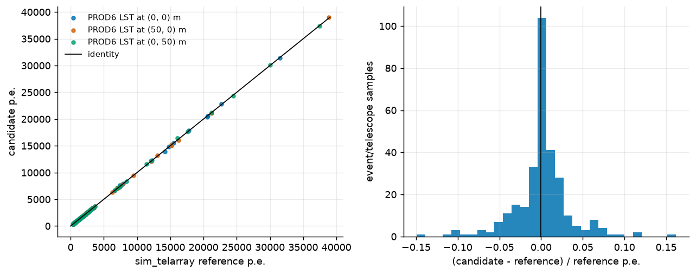

*Camera p.e. per telescope event, colour per telescope (type and position in the legend): round trip against direct sim_telarray (left), relative difference (right).*

## 2. Atmosphere (propagation)

obdeect propagation (extinction, refraction, travel time) against analytic results, sim_telarray's extinction tables and the compiled CORSIKA atmosphere code.

<!-- notes:propagation -->

<!-- /notes -->

### Extinction vs analytic Beer–Lambert — PASS

Case: Beer-Lambert constant optical depth (analytic reference)

Atmospheric transmission for an exponential atmosphere against the analytic Beer–Lambert result, zenith 0–60°.

| Quantity | Value |
|---|---|
| Samples | 16 |
| Largest transmission error | 0.0e+00 |

`propagation.extinction-analytic`: 2/2 gated checks pass. [metrics.json](propagation.extinction-analytic/metrics.json)

### Extinction vs sim_telarray tables — PASS

Case: Real sim_telarray transmission table, telescope path and thinning

Extinction from a sim_telarray optical-depth table against sim_telarray's own interpolation, for wavelengths, heights, zenith angles, telescope elevations and in-telescope path lengths; weighted and thinned modes.

| Quantity | Value |
|---|---|
| Grid (wavelengths × heights × zeniths) | 9 × 5 × 4 |
| Largest error (weighted mode) | 4.5e-08 |
| Largest error (in-telescope depth) | 4.3e-19 |
| Thinned count residual | 2.77 σ |

`propagation.extinction-simtel-table`: 10/10 gated checks pass. [metrics.json](propagation.extinction-simtel-table/metrics.json)

### Refraction and timing vs CORSIKA atmo — PASS

Case: Atmosphere refraction against compiled CORSIKA IACT/atmo

Refraction and travel time against the compiled CORSIKA atmosphere code (atmo.c) for emission heights 3–20 km and zenith 0–60°.

| Quantity | Value |
|---|---|
| Samples (bent) | 24 (24) |
| Largest displacement error | 4.4e-04 m |
| Largest travel-time error | 1.6e-03 ns |
| Largest direction-cosine error | 1.6e-12 |

`propagation.atmosphere-corsika`: 5/5 gated checks pass. [metrics.json](propagation.atmosphere-corsika/metrics.json)

## 3. Light sources

obdeect light sources against the sim_telarray LightEmission programs and analytic expectations: photon yield, directions, times and wavelengths at emission, then camera photoelectrons in sim_telarray. Signed values are obdeect / reference − 1; ratios are obdeect / reference.

<!-- notes:sources -->
Failures:

- Point source vs xyzls: time offset −0.70 ns (photons in common acceptance 0.994 ± 0.012;
  camera p.e. 0.996 ± 0.006 pass).
- Flasher secondary vs ff-gct: time mean +0.12 ns, RMS +7 % (photons and directions agree).
- Muon track vs fake-muon: time −0.77 ns, reference spread 2× (yield and Cherenkov angle agree,
  camera p.e. 0.994 ± 0.008).
- Night sky vs nsbls: impact-point and time distributions differ, and nsbls also fails the
  analytic flat-flux test (yield and rate exact, 0.24 ph/sr/ns/cm²).
<!-- /notes -->

### LED vs pixled — PASS

Case: sources.led-reference

LED in the camera against the pixled reference program: identical photons expected.

| Quantity | Value |
|---|---|
| Photons (obdeect / reference) | 60 / 60 |
| Largest per-event photon difference | 0.0 |
| Position centroid difference | 1.05e-08 cm |

`sources.led-reference`: 8/8 gated checks pass. [metrics.json](sources.led-reference/metrics.json) · [details.json](sources.led-reference/details.json)

### Flasher on the dish vs ff-1m — PASS

Case: Dish flasher versus ff-1m (emission; camera stage in details.json)

Flasher on the dish axis against ff-1m: emission (stage 1), then camera photoelectrons through sim_telarray (stage 2).

| Quantity | Value |
|---|---|
| Photons per event | 0.9987 ± 0.0007 |
| Direction mean cx / cy | +0.48 σ / +1.17 σ |
| Arrival time mean (after frame correction) | -0.006 ± 0.000 ns |
| Camera p.e. | 1.0013 ± 0.0019 |
| Camera image χ²/ndf | 1.01 |

`sources.flasher-dish`: 14/14 gated checks pass. [metrics.json](sources.flasher-dish/metrics.json) · [details.json](sources.flasher-dish/details.json)

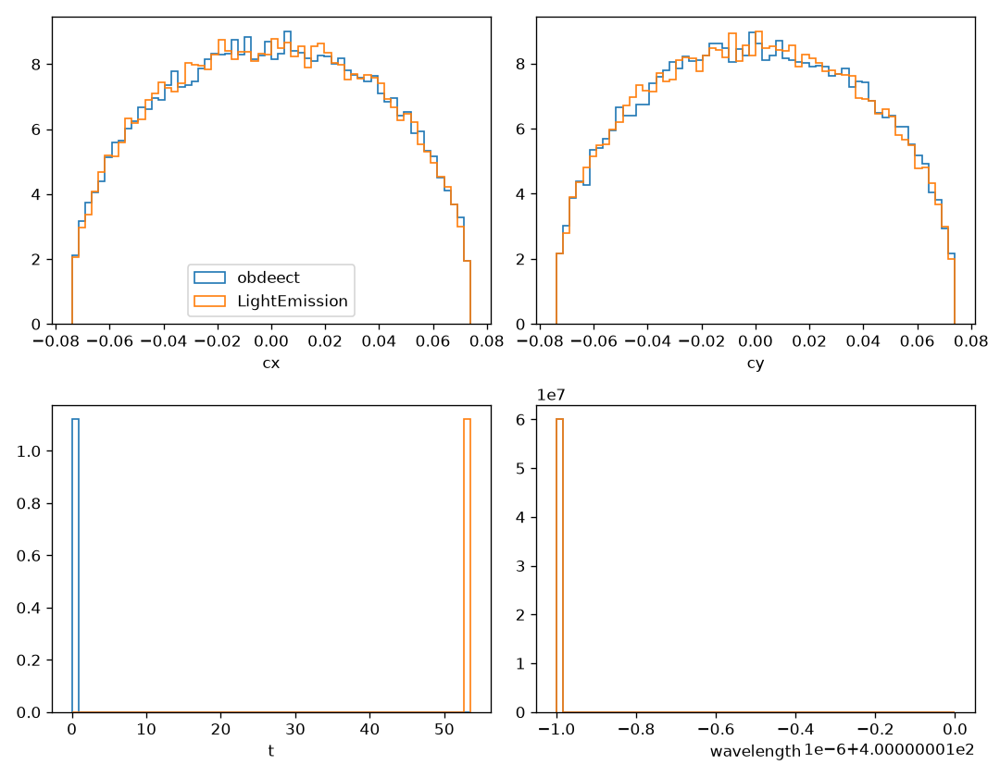

*Emission: direction cosines, arrival time at the reference plane (obdeect times moved to the plane, as in the metrics) and wavelength of obdeect and LightEmission photons.*

### Flasher via secondary mirror vs ff-gct — FAIL

Case: Secondary flasher versus ff-gct (stage 1 emission)

Flashers at the camera corners, light reflected by the secondary mirror, against ff-gct; camera photoelectrons through sim_telarray.

| Quantity | Value |
|---|---|
| Photons per event | 1.0001 ± 0.0022 |
| Arrival time mean | +0.123 ± 0.019 ns |
| Camera p.e. | – |
| Camera image χ²/ndf | – |

`sources.flasher-secondary`: 10/12 gated checks pass; failed: `t_mean_limit_exceeded`, `t_rms_limit_exceeded`. [metrics.json](sources.flasher-secondary/metrics.json) · [details.json](sources.flasher-secondary/details.json)

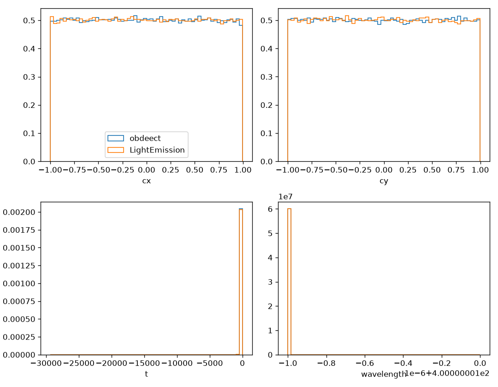

*Emission: direction cosines, arrival time at the reference plane (obdeect times moved to the plane, as in the metrics) and wavelength of obdeect and LightEmission photons.*

### Point source vs xyzls — FAIL

Case: Point source versus xyzls (emission; camera stage in details.json)

Isotropic point source at a distance against xyzls; photons accepted by the telescope and camera photoelectrons.

| Quantity | Value |
|---|---|
| Accepted photons (gated) | 0.994 ± 0.012 |
| Raw photons (recorded only) | 1.038 ± 0.002 |
| Arrival time mean | -0.696 ± 0.001 ns |
| Camera p.e. | 0.996 ± 0.006 |

`sources.point-source`: 13/14 gated checks pass; failed: `t_mean_limit_exceeded`. [metrics.json](sources.point-source/metrics.json) · [details.json](sources.point-source/details.json)

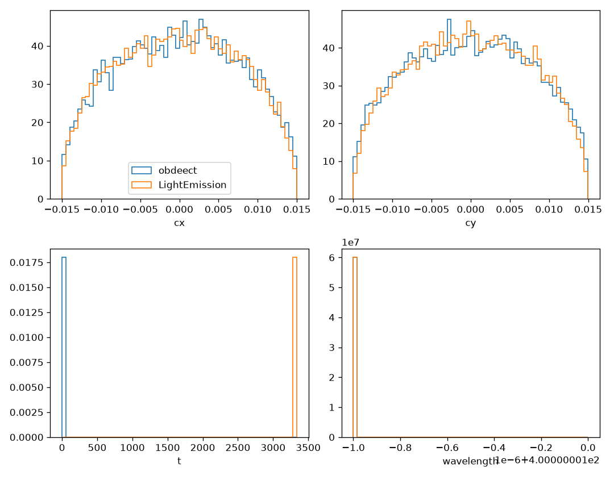

*Emission: direction cosines, arrival time at the reference plane (obdeect times moved to the plane, as in the metrics) and wavelength of obdeect and LightEmission photons.*

### Beam scan vs xyls — PASS

Case: Beam scan versus xyls (emission; camera stage in details.json)

Scanning laser beam against the LightEmission beam program.

| Quantity | Value |
|---|---|
| Photons per event | 1.000 ± 0.006 |
| Direction mean cx / cy | +0.00 σ / +0.00 σ |

`sources.beam-scan`: 12/12 gated checks pass. [metrics.json](sources.beam-scan/metrics.json) · [details.json](sources.beam-scan/details.json)

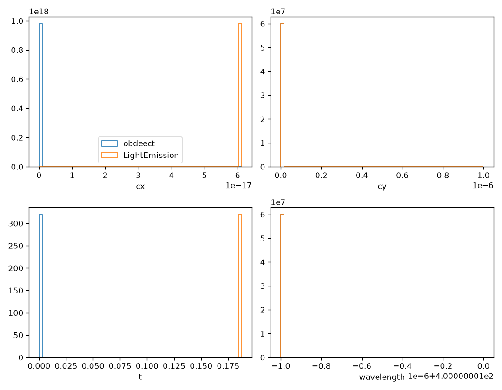

*Emission: direction cosines, arrival time at the reference plane (obdeect times moved to the plane, as in the metrics) and wavelength of obdeect and LightEmission photons.*

### Laser beam geometry vs ls-beam — PASS

Case: Laser beam versus ls-beam: FoV crossing geometry only (yield, direction, time, camera BLOCKED)

Laser beam geometry against ls-beam: where the beam enters and leaves the telescope field of view.

| Quantity | Value |
|---|---|
| Path in the field of view (obdeect / reference) | 131.60 / 131.65 m |
| Entry / exit offset | 0.00 / 0.05 m |

`sources.laser-beam`: 6/6 gated checks pass. [metrics.json](sources.laser-beam/metrics.json) · [details.json](sources.laser-beam/details.json)

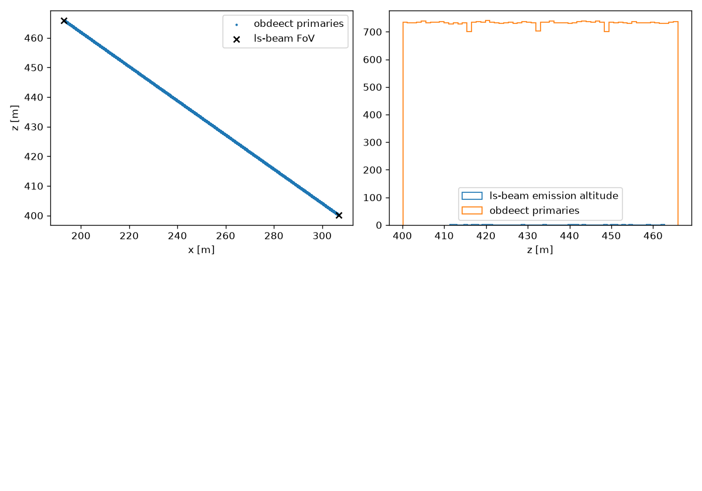

*Beam path of obdeect and ls-beam relative to the field of view.*

### Night sky vs analytic and nsbls — FAIL

Case: Night sky versus nsbls: rate, direction, projected area, time

Night-sky background source against the analytic flux and nsbls; camera photoelectrons through sim_telarray.

| Quantity | Value |
|---|---|
| Rate, relative error vs configured | 7.5e-06 |
| Area-uniform entry (KS, critical) | 0.4999 (0.0034) |
| Flat pulse (KS, critical) | 0.0015 (0.0034) |
| Camera p.e. vs nsbls (recorded only) | – |

`sources.night-sky`: 12/17 gated checks pass; failed: `projected_area_uniform_native_vs_analytic_ks_limit_exceeded`, `projected_area_uniform_reference_vs_analytic_ks_limit_exceeded`, `impact_parameter_native_vs_reference_ks_limit_exceeded`, `time_reference_vs_pulse_ks_limit_exceeded`, `time_native_vs_reference_ks_limit_exceeded`. [metrics.json](sources.night-sky/metrics.json) · [details.json](sources.night-sky/details.json)

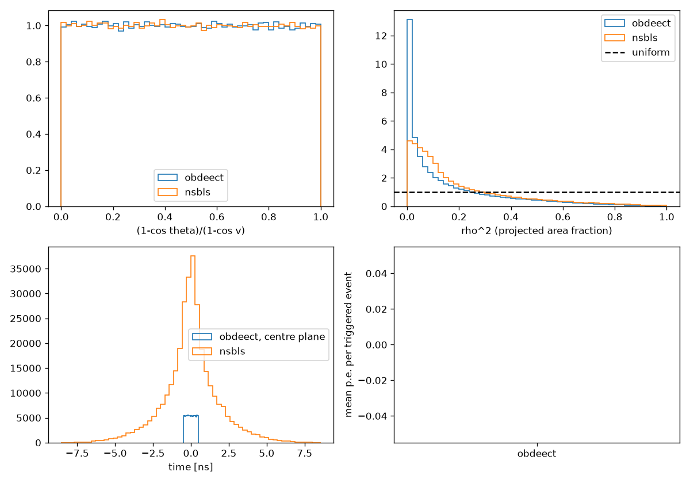

*Angular distribution in the cone, projected entry point (uniform expected), time at the centre plane, and camera p.e. per triggered event.*

### Muon track vs fake-muon and analytic — FAIL

Case: Muon track versus fake-muon: yield, Cherenkov angle, spectrum, time, camera p.e.

Muon track against fake-muon and the analytic Cherenkov expectation; camera photoelectrons through sim_telarray.

| Quantity | Value |
|---|---|
| Photon yield (obdeect / fake-muon) | 1.0003 ± 0.0029 |
| Time vs analytic | – |
| Camera p.e. | 0.994 ± 0.008 |

`sources.muon-track`: 15/17 gated checks pass; failed: `time_mean_difference_ns_limit_exceeded`, `time_native_vs_reference_ks_limit_exceeded`. [metrics.json](sources.muon-track/metrics.json) · [details.json](sources.muon-track/details.json)

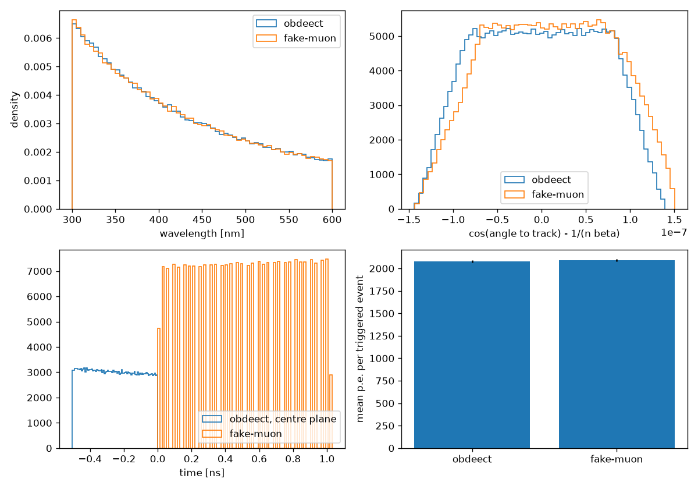

*Wavelength against 1/λ², Cherenkov angle residual, arrival time against the analytic distribution (black), and camera p.e. per triggered event.*

## 4. Telescope optics

Ray tracing of obdeect against sim_telarray for the same telescope model, star light at 0–4° off axis along two directions: PSF (D80), effective mirror area and effective focal length.

<!-- notes:optics -->

<!-- /notes -->

### Optics lst-6.0.2 — PASS

Case: Optics LSTN-01 (model 6.0.2): simtools sim_telarray vs obdeect, offsets 0-4 deg, N/E

sim_telarray ray tracing (via simtools) against obdeect for the same telescope model: a star at 10 km, 0–4° off axis, moved along x (E/W) and along y (N/S). PSF (D80), effective mirror area and effective focal length per offset.

| Quantity | Value |
|---|---|
| Offsets | 9 |
| Largest PSF (D80) difference | 0.53% |
| Largest effective area difference | 0.09% |
| Largest effective focal length difference | 0.018% |

`optics.lst-6.0.2`: 5/5 gated checks pass. [metrics.json](optics.lst-6.0.2/metrics.json) · [details.json](optics.lst-6.0.2/details.json)

*obdeect (blue) and sim_telarray (orange) against off-axis angle; filled circles and solid lines: star offset along x (E/W), open squares and dashed lines: along y (N/S). On axis there is one point.*

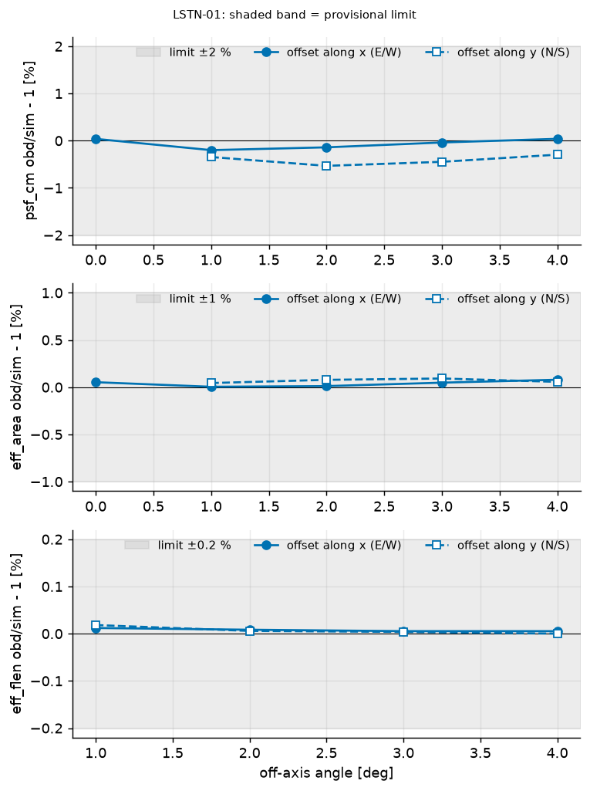

*obdeect / sim_telarray − 1 against off-axis angle, per offset direction; shaded band = provisional limit.*

Plots written by simtools (one program each): [obdeect/validate_optics_LSTN-01_eff_area.png](optics.lst-6.0.2/obdeect/validate_optics_LSTN-01_eff_area.png) · [obdeect/validate_optics_LSTN-01_eff_flen.png](optics.lst-6.0.2/obdeect/validate_optics_LSTN-01_eff_flen.png) · [obdeect/validate_optics_LSTN-01_psf_cm.png](optics.lst-6.0.2/obdeect/validate_optics_LSTN-01_psf_cm.png) · [obdeect/validate_optics_LSTN-01_psf_deg.png](optics.lst-6.0.2/obdeect/validate_optics_LSTN-01_psf_deg.png) · [sim_telarray/validate_optics_LSTN-01_eff_area.png](optics.lst-6.0.2/sim_telarray/validate_optics_LSTN-01_eff_area.png) · [sim_telarray/validate_optics_LSTN-01_eff_flen.png](optics.lst-6.0.2/sim_telarray/validate_optics_LSTN-01_eff_flen.png) · [sim_telarray/validate_optics_LSTN-01_psf_cm.png](optics.lst-6.0.2/sim_telarray/validate_optics_LSTN-01_psf_cm.png) · [sim_telarray/validate_optics_LSTN-01_psf_deg.png](optics.lst-6.0.2/sim_telarray/validate_optics_LSTN-01_psf_deg.png)

### Optics mst-6.0.2 — PASS

Case: Optics MSTN-01 (model 6.0.2): simtools sim_telarray vs obdeect, offsets 0-4 deg, N/E

sim_telarray ray tracing (via simtools) against obdeect for the same telescope model: a star at 10 km, 0–4° off axis, moved along x (E/W) and along y (N/S). PSF (D80), effective mirror area and effective focal length per offset.

| Quantity | Value |
|---|---|
| Offsets | 9 |
| Largest PSF (D80) difference | 1.32% |
| Largest effective area difference | 0.18% |
| Largest effective focal length difference | 0.059% |

`optics.mst-6.0.2`: 5/5 gated checks pass. [metrics.json](optics.mst-6.0.2/metrics.json) · [details.json](optics.mst-6.0.2/details.json)

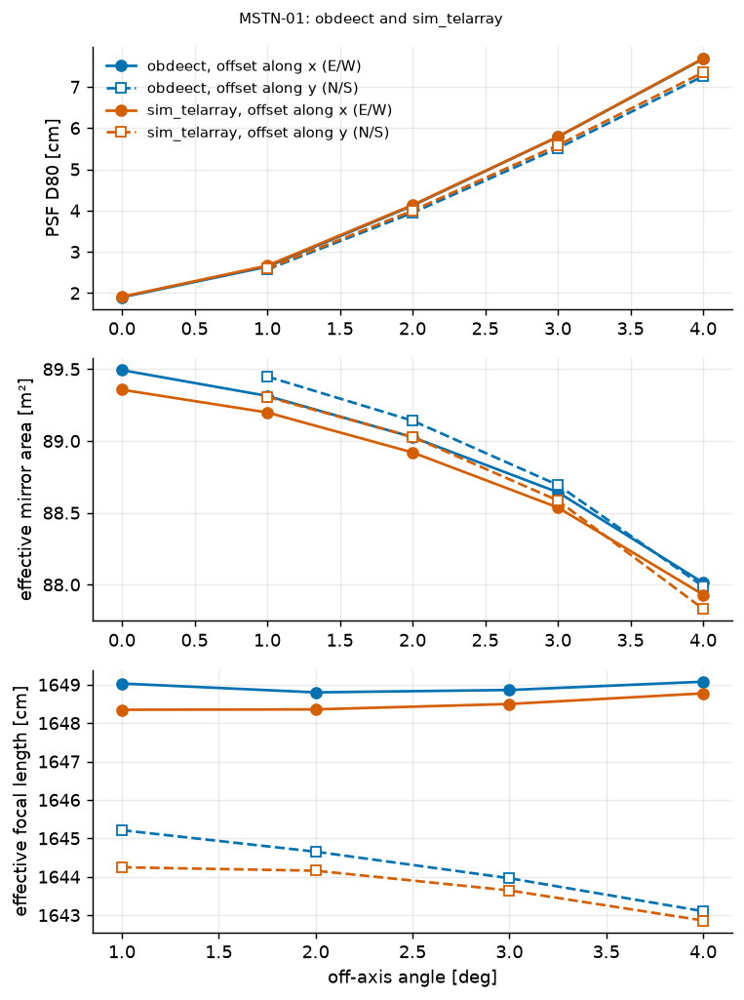

*obdeect (blue) and sim_telarray (orange) against off-axis angle; filled circles and solid lines: star offset along x (E/W), open squares and dashed lines: along y (N/S). On axis there is one point.*

*obdeect / sim_telarray − 1 against off-axis angle, per offset direction; shaded band = provisional limit.*

Plots written by simtools (one program each): [obdeect/validate_optics_MSTN-01_eff_area.png](optics.mst-6.0.2/obdeect/validate_optics_MSTN-01_eff_area.png) · [obdeect/validate_optics_MSTN-01_eff_flen.png](optics.mst-6.0.2/obdeect/validate_optics_MSTN-01_eff_flen.png) · [obdeect/validate_optics_MSTN-01_psf_cm.png](optics.mst-6.0.2/obdeect/validate_optics_MSTN-01_psf_cm.png) · [obdeect/validate_optics_MSTN-01_psf_deg.png](optics.mst-6.0.2/obdeect/validate_optics_MSTN-01_psf_deg.png) · [sim_telarray/validate_optics_MSTN-01_eff_area.png](optics.mst-6.0.2/sim_telarray/validate_optics_MSTN-01_eff_area.png) · [sim_telarray/validate_optics_MSTN-01_eff_flen.png](optics.mst-6.0.2/sim_telarray/validate_optics_MSTN-01_eff_flen.png) · [sim_telarray/validate_optics_MSTN-01_psf_cm.png](optics.mst-6.0.2/sim_telarray/validate_optics_MSTN-01_psf_cm.png) · [sim_telarray/validate_optics_MSTN-01_psf_deg.png](optics.mst-6.0.2/sim_telarray/validate_optics_MSTN-01_psf_deg.png)

### Optics sst-6.0.2 — PASS

Case: Optics SSTS-01 (dual mirror) (model 6.0.2): simtools sim_telarray vs obdeect, offsets 0-4 deg, N/E

sim_telarray ray tracing (via simtools) against obdeect for the same telescope model: a star at 10 km, 0–4° off axis, moved along x (E/W) and along y (N/S). PSF (D80), effective mirror area and effective focal length per offset.

| Quantity | Value |
|---|---|
| Offsets | 9 |
| Largest PSF (D80) difference | 0.12% |
| Largest effective area difference | 0.39% |
| Largest effective focal length difference | 0.011% |

`optics.sst-6.0.2`: 5/5 gated checks pass. [metrics.json](optics.sst-6.0.2/metrics.json) · [details.json](optics.sst-6.0.2/details.json)

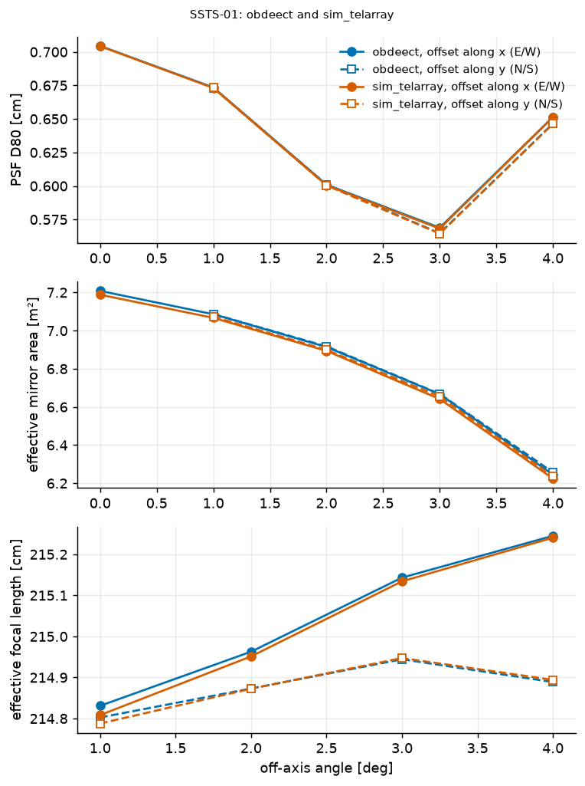

*obdeect (blue) and sim_telarray (orange) against off-axis angle; filled circles and solid lines: star offset along x (E/W), open squares and dashed lines: along y (N/S). On axis there is one point.*

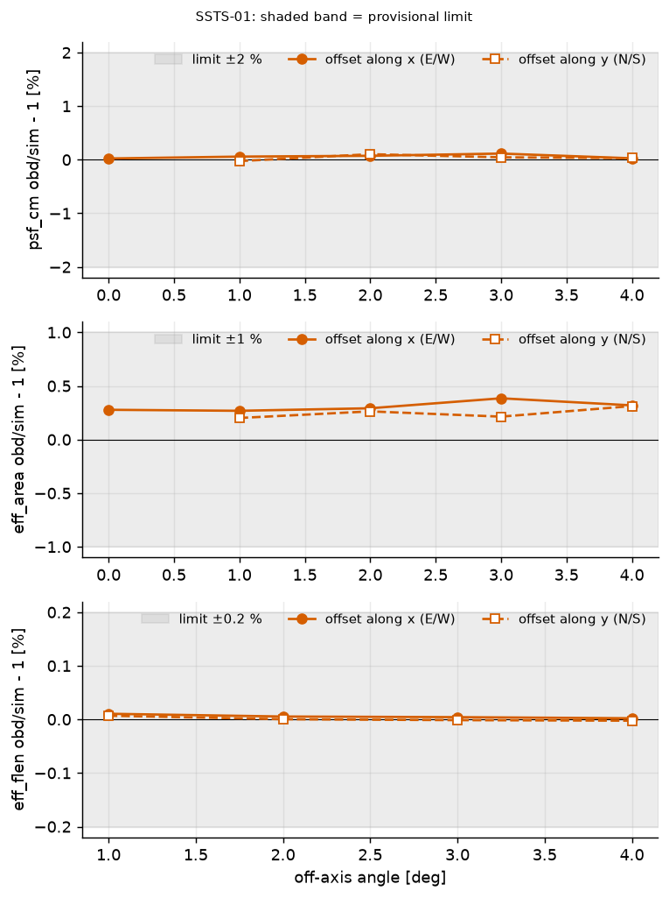

*obdeect / sim_telarray − 1 against off-axis angle, per offset direction; shaded band = provisional limit.*

Plots written by simtools (one program each): [obdeect/validate_optics_SSTS-01_eff_area.png](optics.sst-6.0.2/obdeect/validate_optics_SSTS-01_eff_area.png) · [obdeect/validate_optics_SSTS-01_eff_flen.png](optics.sst-6.0.2/obdeect/validate_optics_SSTS-01_eff_flen.png) · [obdeect/validate_optics_SSTS-01_psf_cm.png](optics.sst-6.0.2/obdeect/validate_optics_SSTS-01_psf_cm.png) · [obdeect/validate_optics_SSTS-01_psf_deg.png](optics.sst-6.0.2/obdeect/validate_optics_SSTS-01_psf_deg.png) · [sim_telarray/validate_optics_SSTS-01_eff_area.png](optics.sst-6.0.2/sim_telarray/validate_optics_SSTS-01_eff_area.png) · [sim_telarray/validate_optics_SSTS-01_eff_flen.png](optics.sst-6.0.2/sim_telarray/validate_optics_SSTS-01_eff_flen.png) · [sim_telarray/validate_optics_SSTS-01_psf_cm.png](optics.sst-6.0.2/sim_telarray/validate_optics_SSTS-01_psf_cm.png) · [sim_telarray/validate_optics_SSTS-01_psf_deg.png](optics.sst-6.0.2/sim_telarray/validate_optics_SSTS-01_psf_deg.png)

## 5. Full chain

obdeect stages inserted into the CORSIKA → sim_telarray chain, compared event by event with the direct sim_telarray run on the same showers and seeds. Bias = obdeect / reference − 1 of camera photoelectrons, with its standard error.

<!-- notes:chain -->

<!-- /notes -->

### Near-threshold showers (20–100 GeV), stream round trip — PASS

Case: Near-threshold CORSIKA showers (20-100 GeV): stream round trip and sim_telarray camera

Stream round trip for near-threshold showers (20–100 GeV), where single photons decide the trigger. Array: three PROD6 LSTs (sim_telarray `CTA-PROD6-LST.cfg`, not the simulation-models release) at the CTAO-North altitude of 2156 m, at x, y = (0, 0), (50, 0) and (0, 50) m; gamma showers at 20° zenith.

| Quantity | Value |
|---|---|
| Telescope events compared | 291 |
| Camera p.e. bias | +0.00% ± 0.00% |
| Trigger mismatches | 0 |

`chain.stream-roundtrip-threshold`: 6/6 gated checks pass. [metrics.json](chain.stream-roundtrip-threshold/metrics.json) · [details.json](chain.stream-roundtrip-threshold/details.json)

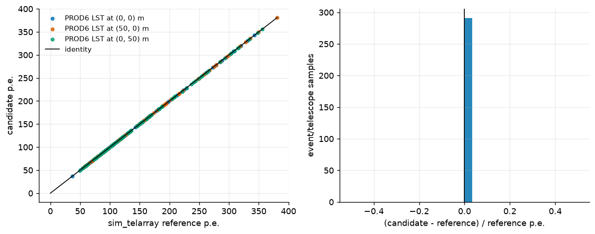

*Camera p.e. per telescope event, colour per telescope (type and position in the legend): round trip against direct sim_telarray (left), relative difference (right).*

### obdeect atmosphere + sim_telarray optics and camera — PASS

Case: obdeect atmosphere substitution vs sim_telarray atmosphere (20 deg, CORSIKA band)

obdeect atmosphere (extinction) replaces sim_telarray's: CORSIKA → obdeect propagation → sim_telarray with a zero optical-depth table, against sim_telarray with its own table. Array: three PROD6 LSTs (sim_telarray `CTA-PROD6-LST.cfg`, not the simulation-models release) at the CTAO-North altitude of 2156 m, at x, y = (0, 0), (50, 0) and (0, 50) m; gamma showers at 20° zenith.

| Quantity | Value |
|---|---|
| Telescope events compared | 300 |
| Camera p.e. bias | +0.12% ± 0.15% |
| Image χ²/ndf | 1.12 |
| Trigger mismatches | 0.0 |

`chain.atmosphere-substitution`: 12/12 gated checks pass. [metrics.json](chain.atmosphere-substitution/metrics.json) · [details.json](chain.atmosphere-substitution/details.json)

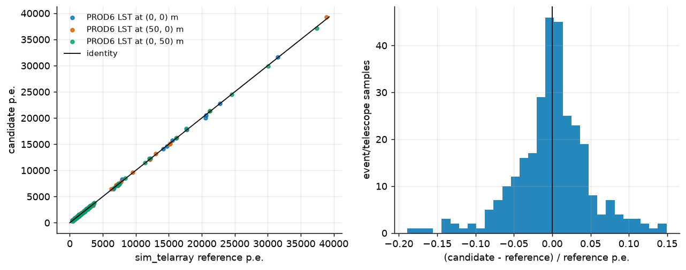

*Camera p.e. per telescope event, colour per telescope (type and position in the legend): obdeect atmosphere against sim_telarray's (left), relative difference (right).*

### obdeect atmosphere and optics + sim_telarray camera — PASS

Case: CORSIKA -> obdeect trace-stream -> sim_telarray camera (Bypass_Optics=1) vs direct sim_telarray, matched LSTN-01 7.0.0 model, unit atmosphere

obdeect atmosphere and optics replace sim_telarray's: CORSIKA → obdeect propagation → obdeect trace-stream → sim_telarray camera only, against the direct sim_telarray run. Telescope: one LSTN-01, simulation models 7.0.0, CTAO-North, from the configuration simtools generates; gamma showers at 20° zenith.

| Quantity | Value |
|---|---|
| Telescope events compared | 100 |
| Camera p.e. bias | +0.06% ± 0.19% |
| Image χ²/ndf | 0.99 |
| Mean arrival-time difference | +0.022 ns |
| Trigger mismatches | 0 |

`chain.optics-bypass1`: 6/6 gated checks pass. [metrics.json](chain.optics-bypass1/metrics.json) · [details.json](chain.optics-bypass1/details.json)

*Camera p.e. per telescope event, colour per telescope (type and position in the legend): obdeect chain against direct sim_telarray (left), relative difference (right).*

## 6. Performance

Wall and CPU time of the obdeect chain against sim_telarray on the same input and machine. Informational, no limits.

<!-- notes:performance -->
Separate report-only run (one thread, shared host): stream from-corsika 35 M photons/s,
to-simtel 49 M/s, propagation 24 M/s, trace-stream 3.1 M/s; direct sim_telarray 4.6 M/s on
the same showers.
<!-- /notes -->

### Stage throughput — REPORT ONLY

Throughput of each chain stage on one CORSIKA input.

`performance.stages`: 0/0 gated checks pass. [metrics.json](performance.stages/metrics.json) · [details.json](performance.stages/details.json)

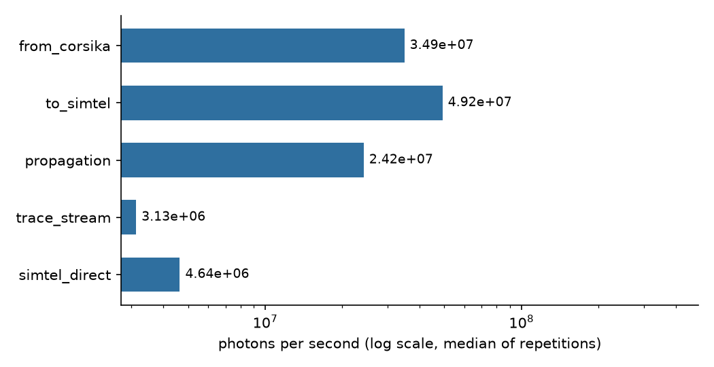

*Photons per second for each stage.*

## Scope and limits

<!-- notes:end -->
Limits are set before the runs and recorded in each `details.json`. Optics limits
(2 % D80, 1 % area, 0.2 % focal length) and source limits are provisional and need
scientific approval.

Not covered: sim_telarray `Bypass_Optics=3` (absent from the sim_telarray checkout at the time),
so the optics chain uses mode 1 and covers single-mirror telescopes only; scattered
laser light (obdeect propagation has no scattering source term yet); camera-level
night-sky and flasher-secondary comparisons (no triggers at the matched light level);
zenith angles other than 20° in the shower chain (CORSIKA data files not available
in the container); per-mirror and incident-angle optics cases.
<!-- /notes -->
