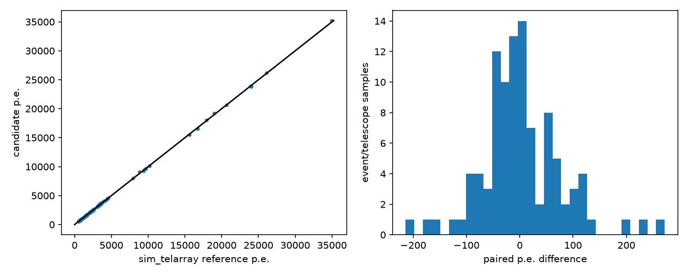
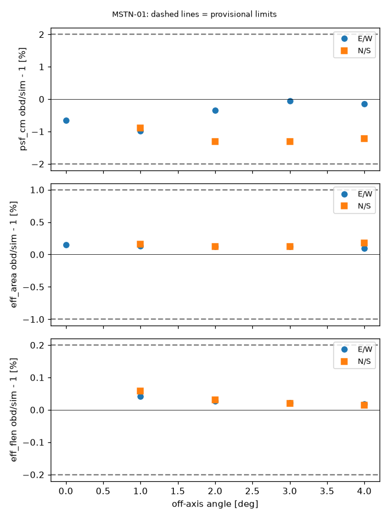

# obdeect versus sim_telarray, 2026-11-13

Run: `obdeect-validate run --suite suites/full.json --environment environments/workspace.json`
in the simtools-prod based container; obdeect `0.8.1.dev27+g7544a7978` plus the
trace-stream index fix, sim_telarray v2025-11-30-rc (released binary), models 6.0.2
(optics) and 7.0.0 (chain). `chain.atmosphere-substitution` is from a rerun after
staging its CORSIKA log; the first run was ERROR (missing input). Performance is a
separate report-only run. Each case directory holds `metrics.json`, `details.json`
(limits, parameter mapping) and its figure. Signed values are obdeect / reference − 1.

**Result: 14 PASS, 5 FAIL.** Four failures are source timing or impact-point
conventions, one is the EventIO block order for light-source streams. Every photon
count, direction and camera p.e. comparison passes.

| Stage | Case | Agreement | Verdict |
|---|---|---|---|
| Stream | CORSIKA → stream → sim_telarray | 100 events: p.e. +0.07 ± 0.09 %, 0 trigger mismatches, codec within float32 bounds | PASS |
| Stream | near-threshold showers (20–100 GeV) | 97 events identical (p.e. bias 0, 0 trigger mismatches) | PASS |
| Stream | LED stream → EventIO, strict reader | INPUTCFG (1212) written at run end, CORSIKA writes it after RUNH; photons identical after reordering | FAIL |
| Propagation | analytic Beer–Lambert, 0–60° | max transmission error 0 | PASS |
| Propagation | sim_telarray extinction tables | 9 λ × 5 heights × 4 zenith × 2 elevations × 2 path lengths: max error 0 | PASS |
| Propagation | refraction/timing vs compiled CORSIKA atmo | 24 samples: direction 0, displacement 0.44 mm, time 1.6 ps | PASS |
| Chain | obdeect atmosphere + sim_telarray camera | 300 telescope events: p.e. +0.12 ± 0.15 %, image χ² 1.12, time −0.004 ns | PASS |
| Optics | LST, 0–4°, N/E | D80 0.53 %, area 0.09 %, focal length 0.02 % (max) | PASS |
| Optics | MST | D80 1.32 % (obdeect sharper, all offsets), area 0.18 %, focal length 0.06 % | PASS |
| Optics | SST (dual mirror) | D80 0.12 %, area 0.39 %, focal length 0.01 % | PASS |
| Chain | obdeect optics + sim_telarray camera (Bypass_Optics=1), LSTN-01 7.0.0 | 100 events: p.e. +0.06 ± 0.19 %, image χ² 0.99, time +0.02 ns, 0 trigger mismatches | PASS |
| Sources | LED vs pixled | 60/60 photons, positions identical | PASS |
| Sources | flasher dish vs ff-1m | photons 0.9987 ± 0.0007; time −6 ps; camera p.e. 1.0013 ± 0.0019, χ² 1.01 | PASS |
| Sources | beam scan vs xyls | 60100/60100 photons, directions equal, time 0.018 ns | PASS |
| Sources | laser beam vs ls-beam (geometry) | path 131.60 vs 131.65 m, entry 0.5 mm | PASS |
| Sources | point source vs xyzls | photons in common acceptance 0.994 ± 0.012; camera p.e. 0.996 ± 0.006, χ² 0.97; **time offset −0.70 ns** | FAIL |
| Sources | flasher secondary vs ff-gct | photons 1.0001 ± 0.0022, directions agree; **time mean +0.12 ns, RMS +7 %** | FAIL |
| Sources | muon track vs fake-muon | yield 1.0003 (analytic 1.0004), Cherenkov angle exact, camera p.e. 0.994 ± 0.008; **time −0.77 ns, reference spread 2×** | FAIL |
| Sources | night sky vs nsbls | yield and rate exact (0.24 ph/sr/ns/cm²); **impact-point and time distributions differ**, and nsbls also fails the analytic flat-flux test | FAIL |

Limits are set before the runs and recorded in each `details.json`. Optics limits
(2 % D80, 1 % area, 0.2 % focal length) and source limits are provisional and need
scientific approval.

Not covered: sim_telarray `Bypass_Optics=3` (absent from the sim_telarray checkout),
so the optics chain uses mode 1 and covers single-mirror telescopes only; scattered
laser light (obdeect propagation has no scattering source term yet); camera-level
night-sky and flasher-secondary comparisons (no triggers at the matched light level);
zenith angles other than 20° in the shower chain (CORSIKA data files not available
in the container); per-mirror and incident-angle optics cases.

Performance (`performance.stages`, one thread, shared host, report only): stream
from-corsika 35 M photons/s, to-simtel 49 M/s, propagation 24 M/s, trace-stream
3.1 M/s; direct sim_telarray 4.6 M/s on the same showers.

