# obdeect versus sim_telarray, 2026-11-14

<!-- notes:intro -->
Run: `bash obdeect-validation/containers/run-validation.sh full obdeect-validation/results/full-7.0.0`
(suite `full`, 19 cases) in the simtools-prod based container; obdeect `0.8.1.dev52+g6721ba04b`,
sim_telarray v2025-11-30-rc, simulation models 7.0.0 for all cases (optics and chain). Wall time
908 s. Supersedes the earlier 2026-11-14 run that used models 6.0.2 for optics.

Change against the 6.0.2 run (same cases, same limits):

- Optics: numbers differ per telescope; all within the provisional limits (LST D80 0.53 %, MST
  1.32 %, SST area 0.33 % vs 0.39 % before).
- Stream, chain (atmosphere and optics) and propagation: unchanged within the printed precision,
  except the sim_telarray table error (0 → 4.5e-8, still well inside tolerance).
- Sources: camera p.e. ratios moved by about 0.5–1 % (flasher dish 1.0019 → 1.0013; point source
  0.999 → 1.010; flasher secondary 0.996 → 1.001; muon track 0.981 → 0.997). Night sky unchanged
  (0.80). The cause was not isolated: obdeect moved from `0.8.1.dev31` to `dev52` as well as the model.
<!-- /notes -->

**Result: 19 PASS** (suite `full`, status PASS). Each case below shows what is compared, its headline numbers and figures; all metrics are in the case's `metrics.json`, limits and settings in `details.json`.

[6. Performance: obdeect chain against sim_telarray](#step-performance) is at the bottom: 3 FAIL, 6 PASS.

| Step | Case | Headline | Verdict |
|---|---|---|---|
| 1. Photon stream format | [LED stream → sim_telarray EventIO, strict reader](#stream-led-eventio) | photons 60 / 60, block order as CORSIKA: 1 | PASS |
| 1. Photon stream format | [CORSIKA → stream → sim_telarray](#stream-corsika-roundtrip) | p.e. +0.07% ± 0.09%, 0 trigger mismatches | PASS |
| 2. Atmosphere (propagation) | [Extinction vs analytic Beer–Lambert](#propagation-extinction-analytic) | largest transmission error 0.0e+00 | PASS |
| 2. Atmosphere (propagation) | [Extinction vs sim_telarray tables](#propagation-extinction-simtel-table) | largest error 4.5e-08 | PASS |
| 2. Atmosphere (propagation) | [Refraction and timing vs CORSIKA atmo](#propagation-atmosphere-corsika) | displacement 4.4e-04 m, time 1.6e-03 ns | PASS |
| 3. Light sources | [LED vs pixled](#sources-led-reference) | photons 60 / 60 | PASS |
| 3. Light sources | [Flasher on the dish vs ff-1m](#sources-flasher-dish) | photons 1.0015 ± 0.0008, camera p.e. 1.0013 ± 0.0019 | PASS |
| 3. Light sources | [Flasher via secondary mirror vs ff-gct](#sources-flasher-secondary) | photons 1.0002 ± 0.0022, time +0.008 ns, camera p.e. 1.001 ± 0.006 | PASS |
| 3. Light sources | [Point source vs xyzls](#sources-point-source) | accepted photons 0.995 ± 0.012, time +0.004 ns, camera p.e. 1.010 ± 0.010 | PASS |
| 3. Light sources | [Beam scan vs xyls](#sources-beam-scan) | photons 1.000 ± 0.006 | PASS |
| 3. Light sources | [Laser beam geometry vs ls-beam](#sources-laser-beam) | path 131.60 vs 131.65 m | PASS |
| 3. Light sources | [Night sky vs analytic and nsbls](#sources-night-sky) | rate error 9.2e-08, area-uniform KS 0.0006, camera p.e. vs nsbls 0.80 (recorded only) | PASS |
| 3. Light sources | [Muon track vs fake-muon and analytic](#sources-muon-track) | yield 1.0003 ± 0.0029, time vs analytic -1.1e-05 ns, camera p.e. 0.997 ± 0.009 | PASS |
| 4. Telescope optics | [Optics lst-7.0.0](#optics-lst-7-0-0) | D80 ≤ 0.53%, area ≤ 0.09%, focal length ≤ 0.018% | PASS |
| 4. Telescope optics | [Optics mst-7.0.0](#optics-mst-7-0-0) | D80 ≤ 1.32%, area ≤ 0.18%, focal length ≤ 0.059% | PASS |
| 4. Telescope optics | [Optics sst-7.0.0](#optics-sst-7-0-0) | D80 ≤ 0.13%, area ≤ 0.33%, focal length ≤ 0.010% | PASS |
| 5. Full chain | [Near-threshold showers (20–100 GeV), stream round trip](#chain-stream-roundtrip-threshold) | 291 telescope events, p.e. +0.00%, 0 trigger mismatches | PASS |
| 5. Full chain | [obdeect atmosphere + sim_telarray optics and camera](#chain-atmosphere-substitution) | p.e. +0.12% ± 0.15%, image χ² 1.12 | PASS |
| 5. Full chain | [obdeect atmosphere and optics + sim_telarray camera](#chain-optics-bypass1) | p.e. +0.06% ± 0.19%, image χ² 0.99, 0 trigger mismatches | PASS |

## How to read this report

**What is compared.** Each case compares obdeect with a reference: an analytic expectation, a sim_telarray, LightEmission or CORSIKA program, or both. Signed values are obdeect / reference − 1, ratios are obdeect / reference, ± is one standard error.

**What PASS means.** All gated checks of the case are inside limits fixed before the run (`details.json`). Where a reference program is known to be wrong, the case is gated against the analytic expectation, and the comparison with that program is *recorded only*: shown, but not part of the verdict.

**Same frame before comparing.** obdeect light sources write photons where they are emitted, the LightEmission programs where they arrive. Before comparing, obdeect photons are moved to the reference plane (flight time added). The time panels show the arrival times as compared.

**Known features of the reference programs.** Some differences in the plots come from the reference, not from obdeect; each affected case has an *Expected differences* box under its figure.

- ff-1m, ff-gct and fake-muon write times in steps of 1/32 ns: their time histograms show spikes or a comb, obdeect times are continuous. Means and widths are compared.
- nsbls samples the photon entry point wrongly (radius `1 − sqrt(u)` instead of `sqrt(u)`, rotated azimuth): its entry-point, time and camera distributions differ from the analytic expectation, which obdeect follows.
- fake-muon times deviate slightly from the analytic distribution; obdeect follows it.

**Image χ²/ndf (chain cases).** Camera images of the same event and telescope from the two runs, pixel by pixel: mean over pixels with signal of (a − b)² / (a + b), with a, b the photoelectrons of the pixel in each run. Differences from Poisson fluctuations alone give about 1; systematic shape differences give more (limit 2). Values below 1 mean the two runs share part of their fluctuations (e.g. identical photons in the stream round trip). For light sources the summed images are compared the same way (χ² per pixel of the normalised images).

**KS.** Largest difference of two cumulative distributions, compared with the critical value for the sample sizes (in brackets where shown).

**Optics.** The star is moved off axis along x (E/W) and along y (N/S). The optics are not rotationally symmetric, so off axis the two directions give different values; each figure shows both, and both programs must agree for each direction.

## 1. Photon stream format

The obdeect photon stream must carry CORSIKA photons and light-source photons to sim_telarray without loss: CORSIKA → stream → sim_telarray EventIO, compared with sim_telarray on the original CORSIKA file.

<!-- notes:stream -->

<!-- /notes -->

### LED stream → sim_telarray EventIO, strict reader — PASS

Case: LED light-source stream to sim_telarray EventIO, read by the independent eventio reader

An LED light-source stream is converted to sim_telarray EventIO and read back with the independent `eventio` reader.

| Quantity | Value |
|---|---|
| Events (stream / EventIO) | 3 / 3 |
| Photons (stream / EventIO) | 60 / 60 |
| Block order as CORSIKA (1 = yes) | 1 |

`stream.led-eventio`: 9/9 gated checks pass. [metrics.json](stream.led-eventio/metrics.json) · [details.json](stream.led-eventio/details.json)

### CORSIKA → stream → sim_telarray — PASS

Case: CORSIKA IACT -> obdeect stream -> sim_telarray IACT, bunch and camera comparison, plus stream command variants

CORSIKA IACT file → `obdeect stream from-corsika` → `obdeect stream to-simtel` → sim_telarray, against sim_telarray on the CORSIKA file. Also checks the stdin, cat and tee variants. Array: three PROD6 LSTs (sim_telarray `CTA-PROD6-LST.cfg`, not the simulation-models release) at the CTAO-North altitude of 2156 m, at x, y = (0, 0), (50, 0) and (0, 50) m; gamma showers at 20° zenith.

| Quantity | Value |
|---|---|
| Telescope events compared | 300 |
| Camera p.e. bias | +0.07% ± 0.09% |
| Trigger mismatches | 0 |
| Bunch count difference | 0 |
| Largest codec error (in units of the codec bound) | 0.076 |

`stream.corsika-roundtrip`: 14/14 gated checks pass. [metrics.json](stream.corsika-roundtrip/metrics.json) · [details.json](stream.corsika-roundtrip/details.json)

*Camera p.e. per telescope event, colour per telescope (type and position in the legend): round trip against direct sim_telarray (left), relative difference (right).*

## 2. Atmosphere (propagation)

obdeect propagation (extinction, refraction, travel time) against analytic results, sim_telarray's extinction tables and the compiled CORSIKA atmosphere code.

<!-- notes:propagation -->

<!-- /notes -->

### Extinction vs analytic Beer–Lambert — PASS

Case: Beer-Lambert constant optical depth (analytic reference)

Atmospheric transmission for an exponential atmosphere against the analytic Beer–Lambert result, zenith 0–60°.

| Quantity | Value |
|---|---|
| Samples | 16 |
| Largest transmission error | 0.0e+00 |

`propagation.extinction-analytic`: 2/2 gated checks pass. [metrics.json](propagation.extinction-analytic/metrics.json)

*Transmission of obdeect and the analytic expectation.*

### Extinction vs sim_telarray tables — PASS

Case: Real sim_telarray transmission table, telescope path and thinning

Extinction from a sim_telarray optical-depth table against sim_telarray's own interpolation, for wavelengths, heights, zenith angles, telescope elevations and in-telescope path lengths; weighted and thinned modes.

| Quantity | Value |
|---|---|
| Grid (wavelengths × heights × zeniths) | 9 × 5 × 4 |
| Largest error (weighted mode) | 4.5e-08 |
| Largest error (in-telescope depth) | 4.3e-19 |
| Thinned count residual | 2.77 σ |

`propagation.extinction-simtel-table`: 10/10 gated checks pass. [metrics.json](propagation.extinction-simtel-table/metrics.json)

*Weighted transmission of obdeect against the sim_telarray table.*

### Refraction and timing vs CORSIKA atmo — PASS

Case: Atmosphere refraction against compiled CORSIKA IACT/atmo

Refraction and travel time against the compiled CORSIKA atmosphere code (atmo.c) for emission heights 3–20 km and zenith 0–60°.

| Quantity | Value |
|---|---|
| Samples (bent) | 24 (24) |
| Largest displacement error | 4.4e-04 m |
| Largest travel-time error | 1.6e-03 ns |
| Largest direction-cosine error | 1.6e-12 |

`propagation.atmosphere-corsika`: 5/5 gated checks pass. [metrics.json](propagation.atmosphere-corsika/metrics.json)

*obdeect − CORSIKA: direction cosine, displacement and travel time against emission height, per zenith angle.*

## 3. Light sources

obdeect light sources against the sim_telarray LightEmission programs and analytic expectations: photon yield, directions, times and wavelengths at emission, then camera photoelectrons in sim_telarray. Signed values are obdeect / reference − 1; ratios are obdeect / reference.

<!-- notes:sources -->
Reference findings (recorded, not judged; details in each `details.json`):

- fake-muon: arrival-time distribution differs from the analytic one by KS 0.021 (mean −5 ps).
- nsbls: entry radius `1 − sqrt(u)` instead of `sqrt(u)` (flux not isotropic, too much light
  at the dish centre), and the entry point is rotated with the azimuth of `d` instead of `−d`
  (`IactLightEmission.cc` ~l.1395), which breaks impact parameters and times. The night-sky camera
  ratio (0.80) is therefore recorded only, not gated; with the same sampler in both programs
  (2026-11-13 run) it was 0.998 ± 0.009.
- ff-gct: near-horizontal photons (|cz| < 0.3) carry a refraction time term of up to 4 ns.
- sim_telarray skips an event block larger than its input buffer (default limits) and still
  exits 0; the flasher-secondary camera stage therefore uses 1e6 photons per flasher. Not an
  obdeect format problem: with `CORSIKA_IO_BUFFER=2GiB MAX_BUNCHES=50000000` the 1.28 GB
  stream is read completely (568833 p.e., 10x the 1e6 run).
- Point source: the raw photon ratio is recorded but not gated; the gated quantity is the
  accepted-photon ratio.
<!-- /notes -->

### LED vs pixled — PASS

Case: sources.led-reference

LED in the camera against the pixled reference program: identical photons expected.

| Quantity | Value |
|---|---|
| Photons (obdeect / reference) | 60 / 60 |
| Largest per-event photon difference | 0.0 |
| Position centroid difference | 1.05e-08 cm |

`sources.led-reference`: 8/8 gated checks pass. [metrics.json](sources.led-reference/metrics.json) · [details.json](sources.led-reference/details.json)

### Flasher on the dish vs ff-1m — PASS

Case: Dish flasher versus ff-1m (emission; camera stage in details.json)

Flasher on the dish axis against ff-1m: emission (stage 1), then camera photoelectrons through sim_telarray (stage 2).

| Quantity | Value |
|---|---|
| Photons per event | 1.0015 ± 0.0008 |
| Direction mean cx / cy | +0.62 σ / -0.66 σ |
| Arrival time mean (after frame correction) | -0.006 ± 0.000 ns |
| Camera p.e. | 1.0013 ± 0.0019 |
| Camera image χ²/ndf | 1.03 |

`sources.flasher-dish`: 14/14 gated checks pass. [metrics.json](sources.flasher-dish/metrics.json) · [details.json](sources.flasher-dish/details.json)

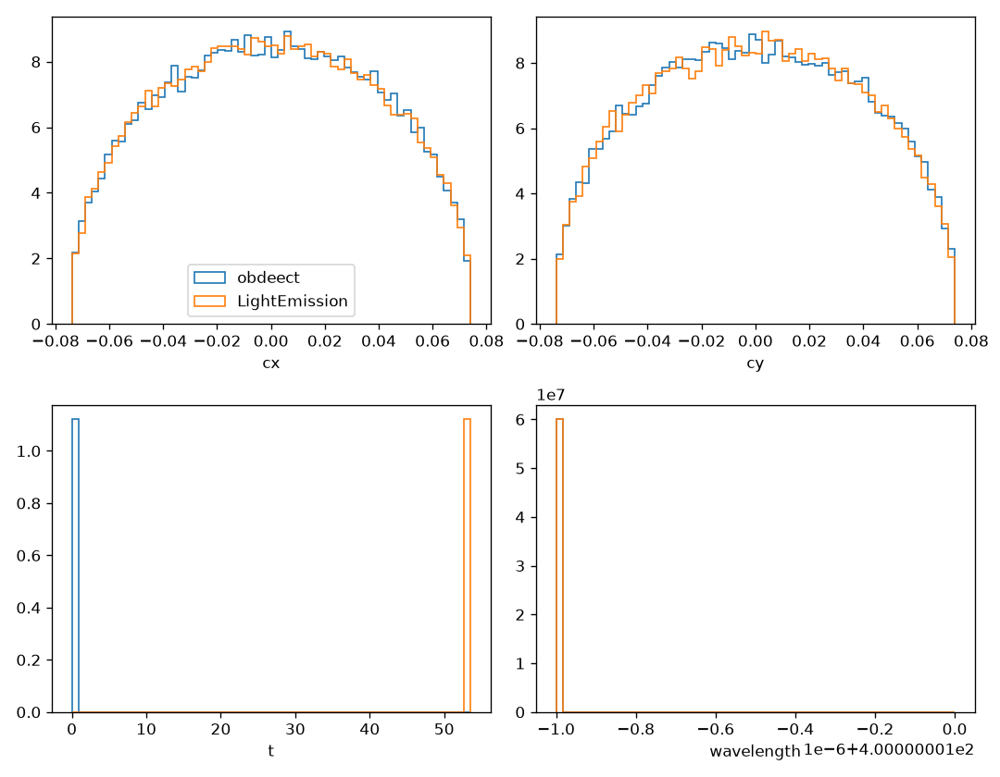

*Emission: direction cosines, arrival time at the reference plane (obdeect times moved to the plane, as in the metrics) and wavelength of obdeect and LightEmission photons.*

> **Expected differences.** Time panel: ff-1m writes times in steps of 1/32 ns, so its histogram is a row of spikes; obdeect times are continuous. Both cover the same window; the mean difference is -0.006 ns (limit 0.05 ns). Wavelength: both are monochromatic.

### Flasher via secondary mirror vs ff-gct — PASS

Case: Secondary flasher versus ff-gct (stage 1 emission)

Flashers at the camera corners, light reflected by the secondary mirror, against ff-gct; camera photoelectrons through sim_telarray.

| Quantity | Value |
|---|---|
| Photons per event | 1.0002 ± 0.0022 |
| Arrival time mean | +0.008 ± 0.003 ns |
| Camera p.e. | 1.0014 ± 0.0059 |
| Camera image χ²/ndf | 1.08 |

`sources.flasher-secondary`: 12/12 gated checks pass. [metrics.json](sources.flasher-secondary/metrics.json) · [details.json](sources.flasher-secondary/details.json)

*Emission: direction cosines, arrival time at the reference plane (obdeect times moved to the plane, as in the metrics) and wavelength of obdeect and LightEmission photons.*

> **Expected differences.** Time panel: ff-gct writes times in steps of 1/32 ns, so its histogram has regular spikes on the same falling distribution; obdeect times are continuous. Mean difference +0.008 ns (limit 0.05 ns). Times are compared with the ff-gct time model: photons with |cz| ≥ 0.3 within the camera radius on both sides.

### Point source vs xyzls — PASS

Case: Point source versus xyzls (emission; camera stage in details.json)

Isotropic point source at a distance against xyzls; photons accepted by the telescope and camera photoelectrons.

| Quantity | Value |
|---|---|
| Accepted photons (gated) | 0.995 ± 0.012 |
| Raw photons (recorded only) | 1.039 ± 0.001 |
| Arrival time mean | +0.004 ± 0.001 ns |
| Camera p.e. | 1.010 ± 0.010 |

`sources.point-source`: 14/14 gated checks pass. [metrics.json](sources.point-source/metrics.json) · [details.json](sources.point-source/details.json)

*Emission: direction cosines, arrival time at the reference plane (obdeect times moved to the plane, as in the metrics) and wavelength of obdeect and LightEmission photons.*

### Beam scan vs xyls — PASS

Case: Beam scan versus xyls (emission; camera stage in details.json)

Scanning laser beam against the LightEmission beam program.

| Quantity | Value |
|---|---|
| Photons per event | 1.000 ± 0.006 |
| Direction mean cx / cy | +0.00 σ / +0.00 σ |

`sources.beam-scan`: 12/12 gated checks pass. [metrics.json](sources.beam-scan/metrics.json) · [details.json](sources.beam-scan/details.json)

*Emission: direction cosines, arrival time at the reference plane (obdeect times moved to the plane, as in the metrics) and wavelength of obdeect and LightEmission photons.*

### Laser beam geometry vs ls-beam — PASS

Case: Laser beam versus ls-beam: FoV crossing geometry only (yield, direction, time, camera BLOCKED)

Laser beam geometry against ls-beam: where the beam enters and leaves the telescope field of view.

| Quantity | Value |
|---|---|
| Path in the field of view (obdeect / reference) | 131.60 / 131.65 m |
| Entry / exit offset | 0.00 / 0.05 m |

`sources.laser-beam`: 6/6 gated checks pass. [metrics.json](sources.laser-beam/metrics.json) · [details.json](sources.laser-beam/details.json)

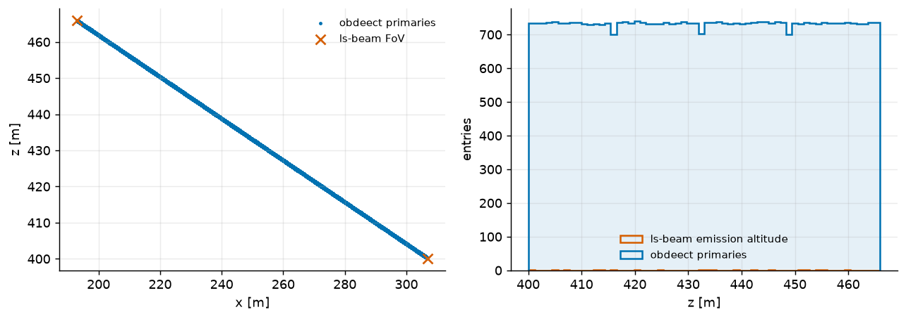

*Beam path of obdeect and ls-beam relative to the field of view.*

### Night sky vs analytic and nsbls — PASS

Case: Night sky versus nsbls: yield, rate, direction, projected area, time, camera p.e.

Night-sky background source against the analytic flux and nsbls; camera photoelectrons through sim_telarray.

| Quantity | Value |
|---|---|
| Rate, relative error vs configured | 9.2e-08 |
| Area-uniform entry (KS, critical) | 0.0006 (0.0011) |
| Flat pulse (KS, critical) | 0.0006 (0.0011) |
| Camera p.e. vs nsbls (recorded only) | 0.796 ± 0.007 |

`sources.night-sky`: 12/12 gated checks pass. [metrics.json](sources.night-sky/metrics.json) · [details.json](sources.night-sky/details.json)

*Angular distribution in the cone, projected entry point (uniform expected), time at the centre plane, and camera p.e. per triggered event.*

> **Expected differences.** The nsbls curves differ because nsbls is wrong, not obdeect. Projected entry point (top right): an isotropic flux is flat in ρ²; obdeect is flat (KS 0.0006, critical 0.0011), nsbls piles up at the centre (KS 0.45) because it draws the radius as 1 − sqrt(u) instead of sqrt(u) and rotates the entry point with the wrong azimuth (`IactLightEmission.cc` ~l.1395). Time (bottom left): the wrong entry points give nsbls a spread of 3.6 ns; obdeect has the configured pulse (0.29 ns). Camera (bottom right): nsbls puts more light on the dish centre, so its camera sees more; obdeect / nsbls = 0.80, recorded only. With the nsbls sampler in obdeect (2026-11-13 report) the camera ratio was 0.998 ± 0.009.

### Muon track vs fake-muon and analytic — PASS

Case: Muon track versus fake-muon: yield, Cherenkov angle, spectrum, time, camera p.e.

Muon track against fake-muon and the analytic Cherenkov expectation; camera photoelectrons through sim_telarray.

| Quantity | Value |
|---|---|
| Photon yield (obdeect / fake-muon) | 1.0003 ± 0.0029 |
| Time vs analytic | -1.1e-05 ns, KS 0.0002 |
| Camera p.e. | 0.997 ± 0.009 |

`sources.muon-track`: 18/18 gated checks pass. [metrics.json](sources.muon-track/metrics.json) · [details.json](sources.muon-track/details.json)

*Wavelength against 1/λ², Cherenkov angle residual, arrival time against the analytic distribution (black), and camera p.e. per triggered event.*

> **Expected differences.** Time (bottom left): fake-muon writes times in steps of 1/32 ns (comb); obdeect follows the analytic distribution (black; mean difference -1.1e-05 ns, KS 0.0002, critical 0.0056). Cherenkov angle (top right): the edges differ by about 1e-7 in cos θ, far below what an image resolves. Wavelength and camera p.e. agree.

## 4. Telescope optics

Ray tracing of obdeect against sim_telarray for the same telescope model, star light at 0–4° off axis along two directions: PSF (D80), effective mirror area and effective focal length.

<!-- notes:optics -->

<!-- /notes -->

### Optics lst-7.0.0 — PASS

Case: Optics LSTN-01 (model 7.0.0): simtools sim_telarray vs obdeect, offsets 0-4 deg, N/E

sim_telarray ray tracing (via simtools) against obdeect for the same telescope model: a star at 10 km, 0–4° off axis, moved along x (E/W) and along y (N/S). PSF (D80), effective mirror area and effective focal length per offset.

| Quantity | Value |
|---|---|
| Offsets | 9 |
| Largest PSF (D80) difference | 0.53% |
| Largest effective area difference | 0.09% |
| Largest effective focal length difference | 0.018% |

`optics.lst-7.0.0`: 5/5 gated checks pass. [metrics.json](optics.lst-7.0.0/metrics.json) · [details.json](optics.lst-7.0.0/details.json)

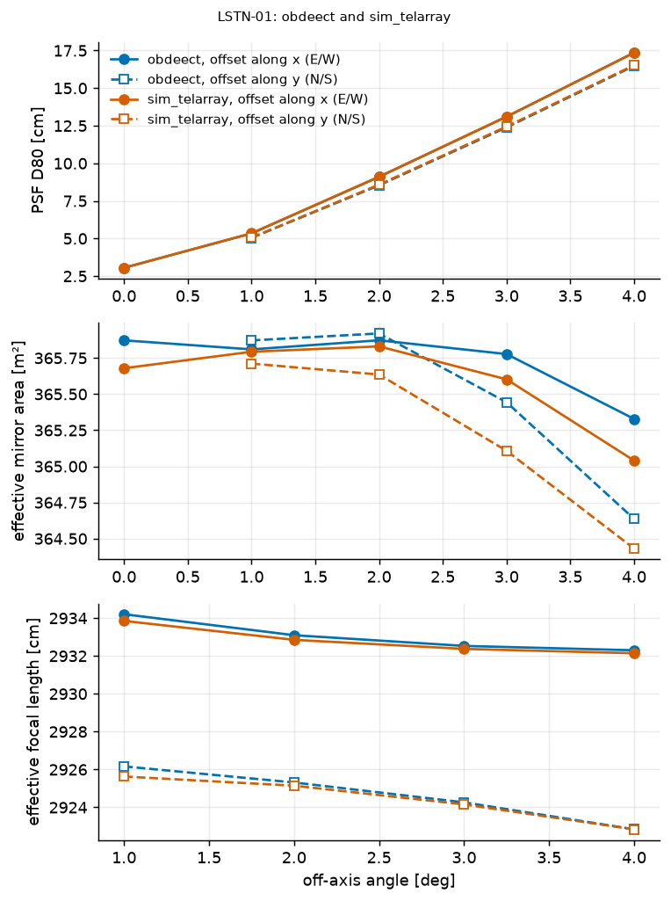

*obdeect (blue) and sim_telarray (orange) against off-axis angle; filled circles and solid lines: star offset along x (E/W), open squares and dashed lines: along y (N/S). On axis there is one point.*

*obdeect / sim_telarray − 1 against off-axis angle, per offset direction; shaded band = provisional limit.*

Plots written by simtools (one program each): [obdeect/validate_optics_LSTN-01_eff_area.png](optics.lst-7.0.0/obdeect/validate_optics_LSTN-01_eff_area.png) · [obdeect/validate_optics_LSTN-01_eff_flen.png](optics.lst-7.0.0/obdeect/validate_optics_LSTN-01_eff_flen.png) · [obdeect/validate_optics_LSTN-01_psf_cm.png](optics.lst-7.0.0/obdeect/validate_optics_LSTN-01_psf_cm.png) · [obdeect/validate_optics_LSTN-01_psf_deg.png](optics.lst-7.0.0/obdeect/validate_optics_LSTN-01_psf_deg.png) · [sim_telarray/validate_optics_LSTN-01_eff_area.png](optics.lst-7.0.0/sim_telarray/validate_optics_LSTN-01_eff_area.png) · [sim_telarray/validate_optics_LSTN-01_eff_flen.png](optics.lst-7.0.0/sim_telarray/validate_optics_LSTN-01_eff_flen.png) · [sim_telarray/validate_optics_LSTN-01_psf_cm.png](optics.lst-7.0.0/sim_telarray/validate_optics_LSTN-01_psf_cm.png) · [sim_telarray/validate_optics_LSTN-01_psf_deg.png](optics.lst-7.0.0/sim_telarray/validate_optics_LSTN-01_psf_deg.png)

### Optics mst-7.0.0 — PASS

Case: Optics MSTN-01 (model 7.0.0): simtools sim_telarray vs obdeect, offsets 0-4 deg, N/E

sim_telarray ray tracing (via simtools) against obdeect for the same telescope model: a star at 10 km, 0–4° off axis, moved along x (E/W) and along y (N/S). PSF (D80), effective mirror area and effective focal length per offset.

| Quantity | Value |
|---|---|
| Offsets | 9 |
| Largest PSF (D80) difference | 1.32% |
| Largest effective area difference | 0.18% |
| Largest effective focal length difference | 0.059% |

`optics.mst-7.0.0`: 5/5 gated checks pass. [metrics.json](optics.mst-7.0.0/metrics.json) · [details.json](optics.mst-7.0.0/details.json)

*obdeect (blue) and sim_telarray (orange) against off-axis angle; filled circles and solid lines: star offset along x (E/W), open squares and dashed lines: along y (N/S). On axis there is one point.*

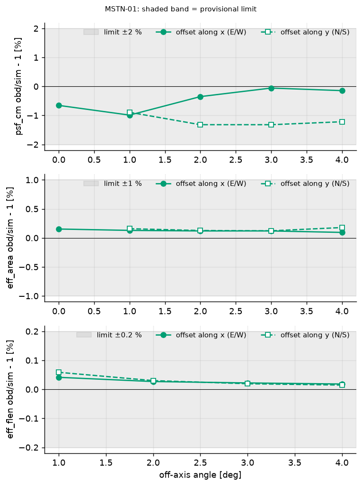

*obdeect / sim_telarray − 1 against off-axis angle, per offset direction; shaded band = provisional limit.*

Plots written by simtools (one program each): [obdeect/validate_optics_MSTN-01_eff_area.png](optics.mst-7.0.0/obdeect/validate_optics_MSTN-01_eff_area.png) · [obdeect/validate_optics_MSTN-01_eff_flen.png](optics.mst-7.0.0/obdeect/validate_optics_MSTN-01_eff_flen.png) · [obdeect/validate_optics_MSTN-01_psf_cm.png](optics.mst-7.0.0/obdeect/validate_optics_MSTN-01_psf_cm.png) · [obdeect/validate_optics_MSTN-01_psf_deg.png](optics.mst-7.0.0/obdeect/validate_optics_MSTN-01_psf_deg.png) · [sim_telarray/validate_optics_MSTN-01_eff_area.png](optics.mst-7.0.0/sim_telarray/validate_optics_MSTN-01_eff_area.png) · [sim_telarray/validate_optics_MSTN-01_eff_flen.png](optics.mst-7.0.0/sim_telarray/validate_optics_MSTN-01_eff_flen.png) · [sim_telarray/validate_optics_MSTN-01_psf_cm.png](optics.mst-7.0.0/sim_telarray/validate_optics_MSTN-01_psf_cm.png) · [sim_telarray/validate_optics_MSTN-01_psf_deg.png](optics.mst-7.0.0/sim_telarray/validate_optics_MSTN-01_psf_deg.png)

### Optics sst-7.0.0 — PASS

Case: Optics SSTS-01 (dual mirror) (model 7.0.0): simtools sim_telarray vs obdeect, offsets 0-4 deg, N/E

sim_telarray ray tracing (via simtools) against obdeect for the same telescope model: a star at 10 km, 0–4° off axis, moved along x (E/W) and along y (N/S). PSF (D80), effective mirror area and effective focal length per offset.

| Quantity | Value |
|---|---|
| Offsets | 9 |
| Largest PSF (D80) difference | 0.13% |
| Largest effective area difference | 0.33% |
| Largest effective focal length difference | 0.010% |

`optics.sst-7.0.0`: 5/5 gated checks pass. [metrics.json](optics.sst-7.0.0/metrics.json) · [details.json](optics.sst-7.0.0/details.json)

*obdeect (blue) and sim_telarray (orange) against off-axis angle; filled circles and solid lines: star offset along x (E/W), open squares and dashed lines: along y (N/S). On axis there is one point.*

*obdeect / sim_telarray − 1 against off-axis angle, per offset direction; shaded band = provisional limit.*

Plots written by simtools (one program each): [obdeect/validate_optics_SSTS-01_eff_area.png](optics.sst-7.0.0/obdeect/validate_optics_SSTS-01_eff_area.png) · [obdeect/validate_optics_SSTS-01_eff_flen.png](optics.sst-7.0.0/obdeect/validate_optics_SSTS-01_eff_flen.png) · [obdeect/validate_optics_SSTS-01_psf_cm.png](optics.sst-7.0.0/obdeect/validate_optics_SSTS-01_psf_cm.png) · [obdeect/validate_optics_SSTS-01_psf_deg.png](optics.sst-7.0.0/obdeect/validate_optics_SSTS-01_psf_deg.png) · [sim_telarray/validate_optics_SSTS-01_eff_area.png](optics.sst-7.0.0/sim_telarray/validate_optics_SSTS-01_eff_area.png) · [sim_telarray/validate_optics_SSTS-01_eff_flen.png](optics.sst-7.0.0/sim_telarray/validate_optics_SSTS-01_eff_flen.png) · [sim_telarray/validate_optics_SSTS-01_psf_cm.png](optics.sst-7.0.0/sim_telarray/validate_optics_SSTS-01_psf_cm.png) · [sim_telarray/validate_optics_SSTS-01_psf_deg.png](optics.sst-7.0.0/sim_telarray/validate_optics_SSTS-01_psf_deg.png)

## 5. Full chain

obdeect stages inserted into the CORSIKA → sim_telarray chain, compared event by event with the direct sim_telarray run on the same showers and seeds. Bias = obdeect / reference − 1 of camera photoelectrons, with its standard error.

<!-- notes:chain -->

<!-- /notes -->

### Near-threshold showers (20–100 GeV), stream round trip — PASS

Case: Near-threshold CORSIKA showers (20-100 GeV): stream round trip and sim_telarray camera

Stream round trip for near-threshold showers (20–100 GeV), where single photons decide the trigger. Array: three PROD6 LSTs (sim_telarray `CTA-PROD6-LST.cfg`, not the simulation-models release) at the CTAO-North altitude of 2156 m, at x, y = (0, 0), (50, 0) and (0, 50) m; gamma showers at 20° zenith.

| Quantity | Value |
|---|---|
| Telescope events compared | 291 |
| Camera p.e. bias | +0.00% ± 0.00% |
| Trigger mismatches | 0 |

`chain.stream-roundtrip-threshold`: 6/6 gated checks pass. [metrics.json](chain.stream-roundtrip-threshold/metrics.json) · [details.json](chain.stream-roundtrip-threshold/details.json)

*Camera p.e. per telescope event, colour per telescope (type and position in the legend): round trip against direct sim_telarray (left), relative difference (right).*

### obdeect atmosphere + sim_telarray optics and camera — PASS

Case: obdeect atmosphere substitution vs sim_telarray atmosphere (20 deg, CORSIKA band)

obdeect atmosphere (extinction) replaces sim_telarray's: CORSIKA → obdeect propagation → sim_telarray with a zero optical-depth table, against sim_telarray with its own table. Array: three PROD6 LSTs (sim_telarray `CTA-PROD6-LST.cfg`, not the simulation-models release) at the CTAO-North altitude of 2156 m, at x, y = (0, 0), (50, 0) and (0, 50) m; gamma showers at 20° zenith.

| Quantity | Value |
|---|---|
| Telescope events compared | 300 |
| Camera p.e. bias | +0.12% ± 0.15% |
| Image χ²/ndf | 1.12 |
| Trigger mismatches | 0.0 |

`chain.atmosphere-substitution`: 12/12 gated checks pass. [metrics.json](chain.atmosphere-substitution/metrics.json) · [details.json](chain.atmosphere-substitution/details.json)

*Camera p.e. per telescope event, colour per telescope (type and position in the legend): obdeect atmosphere against sim_telarray's (left), relative difference (right).*

### obdeect atmosphere and optics + sim_telarray camera — PASS

Case: CORSIKA -> obdeect trace-stream -> sim_telarray camera (Bypass_Optics=1) vs direct sim_telarray, matched LSTN-01 7.0.0 model, unit atmosphere

obdeect atmosphere and optics replace sim_telarray's: CORSIKA → obdeect propagation → obdeect trace-stream → sim_telarray camera only, against the direct sim_telarray run. Telescope: one LSTN-01, simulation models 7.0.0, CTAO-North, from the configuration simtools generates; gamma showers at 20° zenith.

| Quantity | Value |
|---|---|
| Telescope events compared | 100 |
| Camera p.e. bias | +0.06% ± 0.19% |
| Image χ²/ndf | 0.99 |
| Mean arrival-time difference | +0.022 ns |
| Trigger mismatches | 0 |

`chain.optics-bypass1`: 6/6 gated checks pass. [metrics.json](chain.optics-bypass1/metrics.json) · [details.json](chain.optics-bypass1/details.json)

*Camera p.e. per telescope event, colour per telescope (type and position in the legend): obdeect chain against direct sim_telarray (left), relative difference (right).*

## Scope and limits

<!-- notes:end -->
Limits are set before the runs and recorded in each `details.json`; optics and source limits
are provisional and need scientific approval.

Not covered: `Bypass_Optics=3` (not in the sim_telarray release used here; implemented on the
sim_telarray branch `bypass-obdeect-mode-3`, in review), dual-mirror shower chain, scattered
laser light, zenith angles other than 20° in the shower chain, per-mirror and incident-angle
optics cases.
<!-- /notes -->

## 6. Performance: obdeect chain against sim_telarray

How fast is the obdeect chain on the same showers as sim_telarray, and where does the time go? Report only, apart from a few time budgets (checks below each case).

**What is compared**

- **sim_telarray** (today's production): the CORSIKA IACT file goes into sim_telarray, which applies the atmospheric transmission, traces each photon through the telescope optics and simulates the camera, all in one program.
- **obdeect chain**: the same CORSIKA file goes through five programs connected by a pipe: `stream: from-corsika` (reads the photon bunches) → `propagation: run` (atmosphere) → `ray-tracing: trace-stream` (telescope optics) → `stream: to-simtel` (hands the photons on) → sim_telarray with its optics switched off (`Bypass_Optics=3`, camera only). The camera is the same sim_telarray code on both sides, so the differences come from how the photons reach the camera.
- **QE pre-selection** ("envelope" in the code, "efficiency bound" in obdeect): most Cherenkov photons are never detected, because the quantum efficiency (QE) of the photodetectors is at most about 40 % and much lower at most wavelengths. sim_telarray traces every photon through the optics and drops most of them only in the camera. With QE pre-selection, obdeect's propagation keeps each photon already at the start, with a probability just above the best QE at its wavelength (QE / 0.73); the camera then applies the remaining factor (0.73). The expected signal is unchanged, which each run checks by comparing the camera images (photoelectrons, image shape, arrival times), and about nine of ten photons are dropped before the optics. The saving in computing time is much smaller than that: without pre-selection the photons stay in CORSIKA's bunches of several photons, and trace-stream itself drops most of them just before tracing (by the mirror reflectivity), so the work per shower changes less than the photon count.
- Same showers, same telescope models (CTAO North, production 7.0.0, 20° zenith), same machine. Every obdeect program runs with one thread unless a table says otherwise.

**How to read the times**

- **CPU time** is the processor time summed over all programs: what a batch farm pays. **Wall time** is the elapsed time. In a pipe the five obdeect programs run at the same time on different cores, so the chain's wall time is shorter than its CPU time; on a single core it would be at least the CPU time.
- Ratios are obdeect chain / sim_telarray: below 1 means obdeect is faster.
- Building the optical model (`ray-tracing: compile`, about 0.3 s per run) is left out of the chain times unless stated; it is listed on its own.
- **Timing unreliable** = 1: the machine was busy (load above 1) or the repetitions differ by more than 5 %. Repetitions alternate between sim_telarray and obdeect, so both see the same conditions; the "fastest repetition" ratios use the fastest run of each, closest to an idle machine.

Host: Apple M3 Pro (6 performance + 6 efficiency cores), podman VM 6 CPUs

<!-- notes:performance -->
**Run.** 17 November 2026 (`results/perf-2026-11-17b`), each case on its own, one after another. obdeect main with the new native `ray-tracing: trace-stream` (branch `native-trace-stream`, not yet merged); sim_telarray with `Bypass_Optics=3` (commit 4ebb15d). Machine: Apple M3 Pro laptop, podman VM with 6 CPUs. Another container was running (load 1.2–5 on 12 cores), so every case is flagged "timing unreliable" and single numbers can move by 10–20 %. Final numbers need an idle Linux node.

**In short**

1. On one LST, the obdeect chain needs **1.23× (gamma) and 1.26× (proton) the CPU time** of sim_telarray for the same showers and the same camera images (photoelectron bias −0.09 % ± 0.26 %). Its wall time is shorter (0.86× and 0.88×), because the five programs of the pipe run at the same time.
2. **About half of the obdeect CPU is the sim_telarray camera simulation**: 2.3 of 4.2 s for gammas. That is the same code on both sides, so obdeect cannot gain there.
3. **The extra cost is reading the CORSIKA file and the atmosphere.** from-corsika and propagation take 1.55 s together. sim_telarray's whole optics, including the atmosphere, take about 0.5 s. propagation is the next thing to speed up.
4. **The optics are no longer the problem.** The native trace-stream traces the preselected photons in 0.27 s, half of sim_telarray's optics; the Python version took 1.07 s.
5. **For six telescopes the obdeect chain needs less than half the CPU of sim_telarray (0.47×).** One propagation serves several telescopes, and photons are preselected before the optics.
6. **Checks.** The CPU budgets fail (chain ≤ sim_telarray, and reading + atmosphere ≤ 10 % of sim_telarray), as does the 1 GB/s pipe budget, which this machine cannot reach even with a plain copy. All wall-time budgets and all physics checks pass.

Changed since the first run of the day: native trace-stream; repetitions alternate between sim_telarray and obdeect; LightEmission writes an uncompressed file, like obdeect.
<!-- /notes -->

| Case | Headline | Verdict |
|---|---|---|
| [Gamma showers, one LST: obdeect chain against sim_telarray](#performance-air-shower) | obdeect / sim_telarray: CPU 1.23, wall 0.86, p.e. bias -0.1% | FAIL |
| [Proton showers, one LST: obdeect chain against sim_telarray](#performance-air-shower-proton) | obdeect / sim_telarray: CPU 1.26, wall 0.88, p.e. bias -0.1% | FAIL |
| [Which program limits the obdeect pipe?](#performance-bottleneck) | bottleneck: sim_telarray, pipe wall 3.0 s | PASS |
| [Each program on its own](#performance-stages) | trace-stream 53 ns/photon, sim_telarray 63 ns/photon (CPU) | PASS |
| [Start-up cost and threads](#performance-scaling) | fixed cost: compile 0.26 s, trace-stream 0.01 s; 4 threads: speedup 2.4 | PASS |
| [Array of six telescopes (4 LST, 2 MST)](#performance-air-shower-array) | obdeect / sim_telarray: CPU 0.47, wall 0.21 | PASS |
| [How fast photons pass between programs](#performance-stream-pipe) | to-simtel 0.61 GB/s, plain copy 0.90 GB/s | FAIL |
| [Flasher on the dish (LST calibration light)](#performance-flasher-dish) | obdeect / sim_telarray side, wall 0.83 | PASS |
| [Distant point source of light](#performance-point-source) | obdeect / sim_telarray side, wall 0.78 | PASS |

### Gamma showers, one LST: obdeect chain against sim_telarray — FAIL

20 gamma showers (100 GeV–3 TeV, 20° zenith) on LSTN-01. sim_telarray: CORSIKA file → sim_telarray (atmosphere, optics, camera). obdeect chain: one pipe with QE pre-selection, one thread per program. For comparison also timed: the same pipe without QE pre-selection, and the obdeect programs one after another with files in between (no pipe).

| Quantity | Value |
|---|---|
| sim_telarray: wall s, CPU s | 3.54, 3.36 |
| &nbsp;&nbsp;of which optics, CPU s (estimate: full run minus camera-only run) | 0.49 |
| &nbsp;&nbsp;of which camera, CPU s | 2.88 |
| obdeect chain with QE pre-selection: wall s, CPU s | 3.05, 4.15 |
| obdeect chain without QE pre-selection: wall s, CPU s | 3.35, 4.44 |
| obdeect programs one after another (files, no pipe): wall s, CPU s | 7.39, 7.24 |
| ray-tracing: compile, once per run: wall s, CPU s | 0.27, 0.52 |
| **obdeect chain / sim_telarray, CPU** | **1.23** |
| **obdeect chain / sim_telarray, wall** | **0.86** |
| obdeect chain / sim_telarray, CPU, fastest repetitions (compile included) | 1.39 |
| Saving from QE pre-selection (CPU without / with) | 1.07 × |
| Saving from the pipe (CPU of programs one after another / pipe) | 1.51 × |
| Optics: trace-stream CPU without QE pre-selection / sim_telarray optics CPU | 4.01 |
| Timing unreliable | 1 |

| Where the obdeect CPU time goes | With QE pre-selection, CPU s | Share | Without, CPU s | One after another (files), CPU s |
|---|---|---|---|---|
| stream: from-corsika (read the CORSIKA photons) | 0.42 | 10% | 0.40 | 0.40 |
| propagation: run (atmosphere) | 1.13 | 27% | 0.92 | 1.03 |
| ray-tracing: trace-stream (telescope optics) | 0.27 | 7% | 0.72 | 1.95 |
| stream: to-simtel (hand the photons to sim_telarray) | 0.03 | 1% | 0.07 | 0.25 |
| sim_telarray, camera only | 2.29 | 55% | 2.34 | 2.88 |

| Per shower | Wall s per shower | CPU s per shower | CPU ns per photon at the telescope |
|---|---|---|---|
| sim_telarray | 0.177 | 0.168 | 181 |
| obdeect chain with QE pre-selection | 0.165 | 0.233 | 251 |
| obdeect chain without QE pre-selection | 0.180 | 0.248 | 267 |
| obdeect programs one after another | 0.369 | 0.362 | 389 |

| Check | Measured | Result |
|---|---|---|
| Reading + atmosphere (from-corsika + propagation) CPU ≤ 10 % of sim_telarray CPU, programs one after another | 43% | FAIL |
| Reading + atmosphere CPU ≤ 10 % of sim_telarray CPU, in the pipe with QE pre-selection | 49% | FAIL |
| obdeect chain wall ≤ sim_telarray wall (trace-stream on all cores) | 0.88 × sim_telarray | PASS |
| obdeect chain CPU ≤ sim_telarray CPU (trace-stream on all cores) | 1.28 × sim_telarray | FAIL |
| obdeect chain wall ≤ sim_telarray wall (one thread per program) | 0.86 × sim_telarray | PASS |
| obdeect chain CPU ≤ sim_telarray CPU (one thread per program) | 1.23 × sim_telarray | FAIL |
| Same physics: photoelectron bias of the obdeect chain within its limit | -0.09% ± 0.26% | PASS |

All runs completed with their repetitions (9 checks).

<!-- notes:performance-air-shower -->
**Why obdeect needs 23 % more CPU.** sim_telarray takes 3.36 s: about 0.49 s for the optics with the atmosphere, and 2.88 s for the camera (estimate). The obdeect chain takes 4.15 s:

| Program | CPU s |
|---|---|
| sim_telarray camera | 2.29 |
| propagation | 1.13 |
| from-corsika | 0.42 |
| trace-stream | 0.27 |
| to-simtel | 0.03 |

The camera is cheaper in the obdeect chain, because it receives fewer photons. The difference is reading and the atmosphere:
- sim_telarray reads the CORSIKA bunches directly and applies the atmospheric transmission as a table lookup inside its optics.
- obdeect first converts the file into its photon stream (from-corsika), then propagates the bunches and draws each photon against the QE pre-selection (propagation).

Together that is 1.55 s, three times sim_telarray's whole optics.

**Why QE pre-selection saves only 7 %.** It drops about nine of ten photons. Without it, the photons stay in CORSIKA's bunches, and trace-stream drops most of them itself before tracing. The saving is in trace-stream (0.72 → 0.27 s), and the extra draw in propagation eats part of it (0.92 → 1.13 s).

**Why the pipe matters.** Running the programs one after another, with files in between, costs 1.5× the CPU (7.2 s). It writes and reads 350 MB of intermediate files, and the camera receives photon bunches that were not preselected.

**Repeatability.** The sim_telarray repetitions differed by 19 % (busy machine). The fastest-repetition ratio, 1.39, includes the model compile (0.52 s CPU); without the compile it matches 1.23.
<!-- /notes -->

Data: `performance.air-shower` · [metrics.json](performance.air-shower/metrics.json) · [details.json](performance.air-shower/details.json)

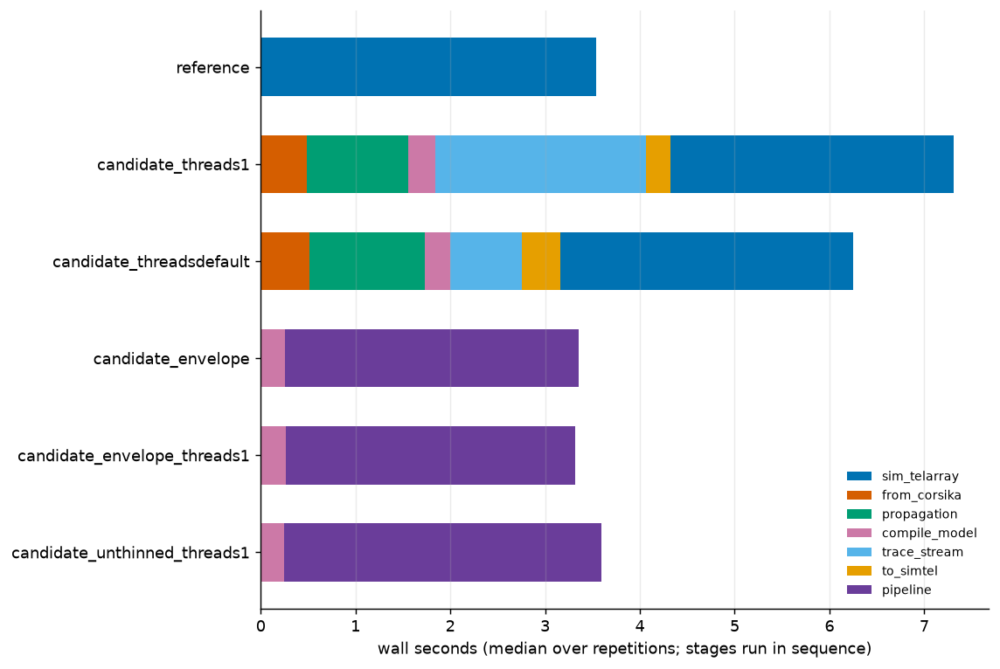

*Wall time per program: sim_telarray and the obdeect variants on the same showers.*

Other figures:

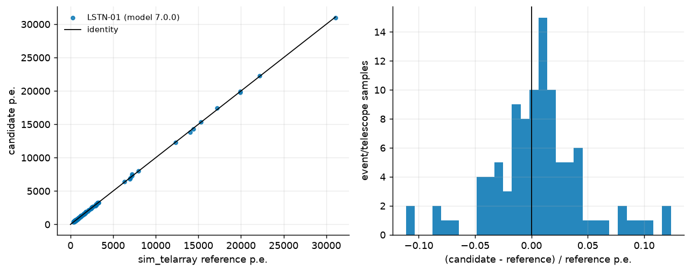
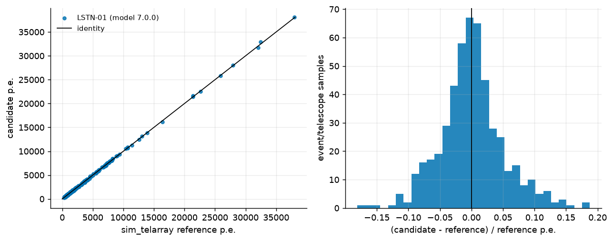

### Proton showers, one LST: obdeect chain against sim_telarray — FAIL

45 proton showers (300 GeV–10 TeV, 20° zenith) on LSTN-01. sim_telarray: CORSIKA file → sim_telarray (atmosphere, optics, camera). obdeect chain: one pipe with QE pre-selection, one thread per program. For comparison also timed: the same pipe without QE pre-selection, and the obdeect programs one after another with files in between (no pipe).

| Quantity | Value |
|---|---|
| sim_telarray: wall s, CPU s | 8.29, 7.87 |
| &nbsp;&nbsp;of which optics, CPU s (estimate: full run minus camera-only run) | 0.80 |
| &nbsp;&nbsp;of which camera, CPU s | 7.08 |
| obdeect chain with QE pre-selection: wall s, CPU s | 7.33, 9.89 |
| obdeect chain without QE pre-selection: wall s, CPU s | 8.03, 10.91 |
| obdeect programs one after another (files, no pipe): wall s, CPU s | 20.57, 18.82 |
| ray-tracing: compile, once per run: wall s, CPU s | 0.29, 0.54 |
| **obdeect chain / sim_telarray, CPU** | **1.26** |
| **obdeect chain / sim_telarray, wall** | **0.88** |
| obdeect chain / sim_telarray, CPU, fastest repetitions (compile included) | 1.31 |
| Saving from QE pre-selection (CPU without / with) | 1.10 × |
| Saving from the pipe (CPU of programs one after another / pipe) | 1.67 × |
| Optics: trace-stream CPU without QE pre-selection / sim_telarray optics CPU | 7.49 |
| Timing unreliable | 1 |

| Where the obdeect CPU time goes | With QE pre-selection, CPU s | Share | Without, CPU s | One after another (files), CPU s |
|---|---|---|---|---|
| stream: from-corsika (read the CORSIKA photons) | 1.06 | 11% | 1.05 | 1.24 |
| propagation: run (atmosphere) | 3.02 | 31% | 2.48 | 3.00 |
| ray-tracing: trace-stream (telescope optics) | 0.75 | 8% | 2.03 | 5.97 |
| stream: to-simtel (hand the photons to sim_telarray) | 0.07 | 1% | 0.18 | 0.98 |
| sim_telarray, camera only | 4.98 | 50% | 5.17 | 7.08 |

| Per shower | Wall s per shower | CPU s per shower | CPU ns per photon at the telescope |
|---|---|---|---|
| sim_telarray | 0.184 | 0.175 | 150 |
| obdeect chain with QE pre-selection | 0.169 | 0.232 | 199 |
| obdeect chain without QE pre-selection | 0.185 | 0.254 | 218 |
| obdeect programs one after another | 0.457 | 0.418 | 359 |

| Check | Measured | Result |
|---|---|---|
| Reading + atmosphere (from-corsika + propagation) CPU ≤ 10 % of sim_telarray CPU, programs one after another | 54% | FAIL |
| Reading + atmosphere CPU ≤ 10 % of sim_telarray CPU, in the pipe with QE pre-selection | 57% | FAIL |
| obdeect chain wall ≤ sim_telarray wall (trace-stream on all cores) | 0.93 × sim_telarray | PASS |
| obdeect chain CPU ≤ sim_telarray CPU (trace-stream on all cores) | 1.33 × sim_telarray | FAIL |
| obdeect chain wall ≤ sim_telarray wall (one thread per program) | 0.88 × sim_telarray | PASS |
| obdeect chain CPU ≤ sim_telarray CPU (one thread per program) | 1.26 × sim_telarray | FAIL |
| Same physics: photoelectron bias of the obdeect chain within its limit | -0.09% ± 0.14% | PASS |

All runs completed with their repetitions (9 checks).

<!-- notes:performance-air-shower-proton -->
**Same picture as for gammas: 1.26× the CPU.** sim_telarray takes 7.87 s, of which about 0.80 s is optics. The obdeect chain takes 9.89 s:

| Program | CPU s |
|---|---|
| sim_telarray camera | 4.98 |
| propagation | 3.02 |
| from-corsika | 1.06 |
| trace-stream | 0.75 |

Reading and the atmosphere (4.1 s) are 57 % of sim_telarray's CPU, more than for gammas (49 %). Proton showers have more photons per shower at the telescope; reading and propagation grow with the photon number, the camera less.
<!-- /notes -->

Data: `performance.air-shower-proton` · [metrics.json](performance.air-shower-proton/metrics.json) · [details.json](performance.air-shower-proton/details.json)

*Wall time per program: sim_telarray and the obdeect variants on the same showers.*

Other figures:

### Which program limits the obdeect pipe? — PASS

The obdeect pipe with QE pre-selection (20 gamma showers, LSTN-01) is built up one program at a time: from-corsika alone, then from-corsika → propagation, and so on, the last program writing its output nowhere. The wall time a program adds is what it costs inside the pipe; the program that adds most limits the whole chain (the bottleneck). CPU s is the program's own CPU time in the full pipe.

| Quantity | Value |
|---|---|
| Bottleneck | sim_telarray |
| Full pipe, wall s | 3.00 |
| Spread of the full pipe over repetitions | 1.0% |

| Program | Wall s it adds | Share of the pipe wall | Its CPU s |
|---|---|---|---|
| stream: from-corsika (read the CORSIKA photons) | 0.34 | 11% | 0.35 |
| propagation: run (atmosphere) | 1.18 | 39% | 1.11 |
| ray-tracing: trace-stream (telescope optics) | 0.14 | 5% | 0.27 |
| stream: to-simtel (hand the photons to sim_telarray) | 0.02 | 1% | 0.03 |
| sim_telarray, camera only | 1.31 | 44% | 2.26 |

All runs completed with their repetitions (5 checks).

<!-- notes:performance-bottleneck -->
With the native trace-stream, **the sim_telarray camera now limits the pipe** (1.31 s of the 3.0 s wall time), followed by propagation (1.18 s). trace-stream adds only 0.14 s. In the first run of the day, with the Python trace-stream, propagation limited the pipe.

So a faster propagation shortens the wall time only until the camera limits it. The CPU time, which is what a batch farm pays, gains in full.
<!-- /notes -->

Data: `performance.bottleneck` · [metrics.json](performance.bottleneck/metrics.json) · [details.json](performance.bottleneck/details.json)

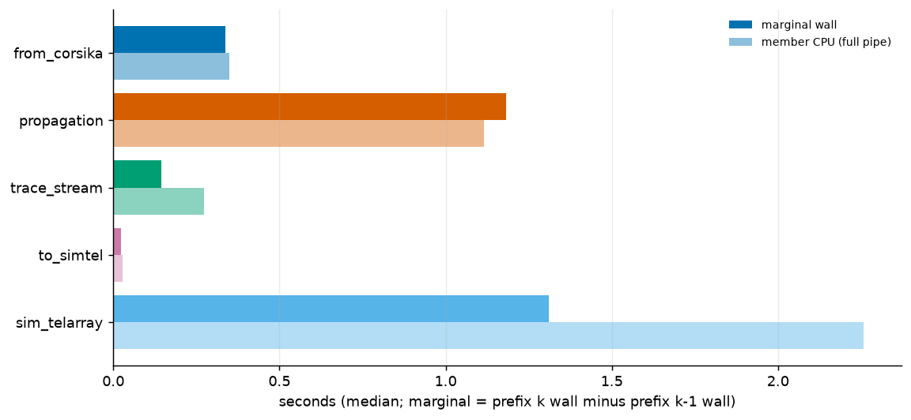

*Wall time each program adds to the pipe (dark) and its CPU time (light).*

### Each program on its own — PASS

Each obdeect program run alone on the 20 gamma showers (input from a file, output to a file), repeated, with sim_telarray (optics and camera) on the same showers for scale. trace-stream here traces the photons without QE pre-selection, about ten times more than in the production pipe. CPU ns per photon: per photon at the telescope (before the atmosphere).

| Quantity | Value |
|---|---|
| Timing unreliable | 1 |
| Load average before the run | 1.27 |

| Program | Wall s | CPU s | Photons/s | CPU ns per photon | Spread over repetitions |
|---|---|---|---|---|---|
| stream: from-corsika (read the CORSIKA photons) | 0.42 | 0.34 | 1.29e+08 | 6 | 14% |
| propagation: run (atmosphere) | 1.19 | 0.97 | 4.54e+07 | 18 | 110% |
| propagation: run with QE pre-selection | 1.11 | 1.05 | 4.88e+07 | 19 | 12% |
| ray-tracing: compile (build the optical model) | 0.26 | 0.54 | – | – | 12% |
| ray-tracing: trace-stream (telescope optics) | 2.13 | 2.02 | 1.78e+07 | 53 | 7% |
| stream: to-simtel (hand the photons to sim_telarray) | 0.29 | 0.18 | 1.88e+08 | 3 | 59% |
| sim_telarray, optics and camera (production) | 3.61 | 3.42 | 1.5e+07 | 63 | 4% |

| Check | Measured | Result |
|---|---|---|
| Photon count unchanged from CORSIKA file to obdeect stream | 1.8e-11 | PASS |
| Photon count unchanged through from-corsika → to-simtel | 1.8e-11 | PASS |

All runs completed with their repetitions (16 checks).

<!-- notes:performance-stages -->
CPU time per photon at the telescope, each program alone:

| Program | ns per photon |
|---|---|
| from-corsika | 6 |
| propagation | 18 (19 with QE pre-selection) |
| trace-stream | 53 (103 with the Python version) |
| to-simtel | 3 |
| sim_telarray, optics and camera | 63 |

trace-stream is the most expensive obdeect program per photon here, because this case feeds it photons that were not preselected. In the production pipe it sees only the preselected ones. The propagation repetitions differed by up to 110 % (busy machine); its median agrees with the pipe cases.
<!-- /notes -->

Data: `performance.stages` · [metrics.json](performance.stages/metrics.json) · [details.json](performance.stages/details.json)

*Photons per second for each program.*

### Start-up cost and threads — PASS

Each obdeect program timed on 0, 10 and 20 gamma showers. A straight line through the three points splits its time into a fixed part (start-up, reading tables, building the model) and a part per shower; small negative fixed parts are noise around zero. Below: ray-tracing: trace-stream with 1, 2, 4 (and 8 if the machine has them) threads on the same photons.

| Quantity | Value |
|---|---|
| Cores | 6 |

| Program | Fixed wall s | Wall s per shower | Fixed CPU s | CPU s per shower | Fixed share for 10 showers |
|---|---|---|---|---|---|
| stream: from-corsika (read the CORSIKA photons) | 0.01 | 0.014 | 0.01 | 0.014 | 7% |
| propagation: run (atmosphere) | 0.02 | 0.057 | 0.04 | 0.046 | 4% |
| ray-tracing: compile (build the optical model) | 0.26 | 0.000 | 0.53 | 0.000 | 100% |
| ray-tracing: trace-stream (telescope optics) | 0.01 | 0.100 | 0.02 | 0.094 | 1% |
| stream: to-simtel (hand the photons to sim_telarray) | 0.01 | 0.009 | 0.01 | 0.009 | 6% |

| trace-stream threads | Wall s | CPU s | Speedup | Efficiency |
|---|---|---|---|---|
| 1 | 1.00 | 0.96 | 1.00 | 100% |
| 2 | 0.59 | 0.96 | 1.71 | 85% |
| 4 | 0.42 | 1.00 | 2.37 | 59% |

All runs completed with their repetitions (6 checks).

<!-- notes:performance-scaling -->
**Fixed cost per run.** Only one program has a noticeable fixed cost: building the optical model (`ray-tracing: compile`), 0.26 s wall and 0.53 s CPU on every run. It is still Python. Everything else starts within a few milliseconds; trace-stream went from 0.24 s to 0.015 s with the native program. With hundreds of showers per production run, the fixed cost does not matter. The compiled model could also be built once and reused.

**Threads.** trace-stream runs 1.7× faster on 2 threads and 2.4× on 4 (60 % efficiency). In the pipe it no longer limits the chain, so threads matter mainly when one telescope is traced alone.
<!-- /notes -->

Data: `performance.scaling` · [metrics.json](performance.scaling/metrics.json) · [details.json](performance.scaling/details.json)

*Left: wall time against the number of showers, with the line fits. Right: trace-stream speedup against threads.*

### Array of six telescopes (4 LST, 2 MST) — PASS

20 gamma showers on LSTN-01 to -04, MSTN-03 and MSTN-15. sim_telarray: one run that simulates all six telescopes (atmosphere, optics, cameras), single-threaded. obdeect chain: telescopes with the same QE share one from-corsika → propagation (QE pre-selection); a `tee` copies that photon stream to one trace-stream → to-simtel → sim_telarray (camera only) branch per telescope. The branches are separate processes that run at the same time, so the CPU ratio is the fair comparison; the wall time profits from the parallel branches. Not compared: the array trigger (each telescope has its own sim_telarray run).

| Quantity | Value |
|---|---|
| sim_telarray, all six telescopes: wall s, CPU s | 40.6, 39.3 |
| obdeect chain with tee: wall s, CPU s | 8.7, 18.4 |
| **obdeect chain / sim_telarray, CPU** | **0.47** |
| **obdeect chain / sim_telarray, wall** | **0.21** |
| obdeect chain / sim_telarray, CPU, fastest repetitions | 0.47 |
| Shared propagation (tee) / one full pipe per telescope, CPU | 0.73 |
| Timing unreliable | 1 |

| Telescope | Photoelectron bias obdeect vs sim_telarray | ± (1 σ) | Images compared | sim_telarray camera CPU s | trace-stream CPU s |
|---|---|---|---|---|---|
| LSTN-01 | +0.68% | 0.47% | 95 | 2.16 | 0.13 |
| LSTN-02 | +0.48% | 0.42% | 99 | 2.32 | 0.20 |
| LSTN-03 | +1.14% | 0.59% | 98 | 2.31 | 0.21 |
| LSTN-04 | +0.21% | 0.39% | 97 | 2.30 | 0.18 |
| MSTN-03 | -0.05% | 0.65% | 64 | 2.53 | 0.10 |
| MSTN-15 | -0.31% | 0.60% | 90 | 2.78 | 0.09 |

| Check | Measured | Result |
|---|---|---|
| obdeect chain wall ≤ sim_telarray wall | 0.21 × sim_telarray | PASS |
| obdeect chain CPU ≤ sim_telarray CPU | 0.47 × sim_telarray | PASS |
| Same physics: photoelectron bias within its limit in all six telescopes | 0 | PASS |
| Photon counts consistent through the chain in all six telescopes | 0 | PASS |

All runs completed with their repetitions (9 checks).

<!-- notes:performance-air-shower-array -->
**obdeect needs less than half the CPU of sim_telarray here** (18.4 s against 39.3 s). Where the obdeect time goes:

| Part | CPU s |
|---|---|
| six camera stages | about 14 (2.2–2.5 each) |
| propagation, shared by all telescopes | 1.5 |
| from-corsika, shared by all telescopes | 1.3 |
| trace-stream, per telescope | 0.1 |

**Not yet understood.** sim_telarray takes 6.5 s per telescope here, against 3.4 s for the single LST. The showers differ (an array input with larger photon spheres around each telescope), so part of it may simply be more photons. A sim_telarray run per telescope on this input would separate the two.

**Physics.** The photoelectron bias is within its limit for all six telescopes (−0.3 % to +1.1 %).
<!-- /notes -->

Data: `performance.air-shower-array` · [metrics.json](performance.air-shower-array/metrics.json) · [details.json](performance.air-shower-array/details.json)

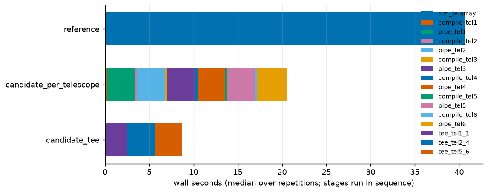

*Wall time per program, sim_telarray and obdeect.*

Other figures:

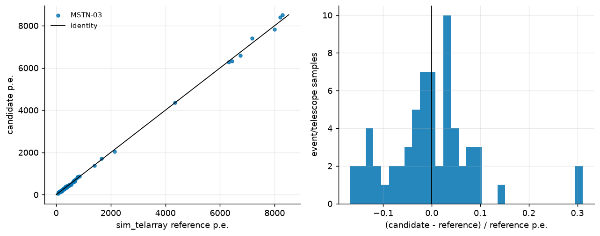

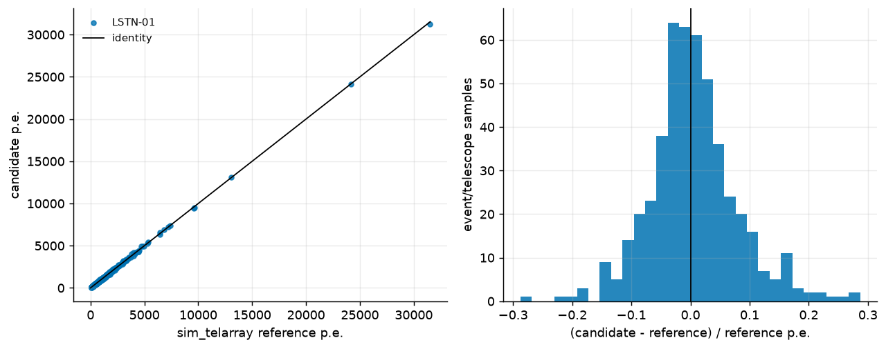

### How fast photons pass between programs — FAIL

The photon stream of the 20 gamma showers (about 350 MB) read with `cat` and written to disk by `tee` (a plain copy: the ceiling of this machine), and converted by `stream: to-simtel` (the last obdeect step before sim_telarray). Throughput in GB/s (10^9 bytes per second); the budget is 1 GB/s.

| Quantity | Value |
|---|---|
| Plain copy (cat → tee), GB/s | 0.90 |
| cat → stream: to-simtel, GB/s | 0.61 |

| Check | Measured | Result |
|---|---|---|
| Plain copy ≥ 1 GB/s | 0.90 GB/s | FAIL |
| stream: to-simtel ≥ 1 GB/s | 0.61 GB/s | FAIL |

All runs completed with their repetitions (2 checks).

<!-- notes:performance-stream-pipe -->
Even a plain copy reaches only 0.90 GB/s in this VM (the podman VM's file system), so the 1 GB/s budget cannot be met on this machine. to-simtel reaches 0.61 GB/s, two thirds of the copy. Its CPU time, 0.37 s for 350 MB (about 1 GB/s), shows that the conversion itself would keep up; the rest is waiting for the disk.
<!-- /notes -->

Data: `performance.stream-pipe` · [metrics.json](performance.stream-pipe/metrics.json) · [details.json](performance.stream-pipe/details.json)

### Flasher on the dish (LST calibration light) — PASS

2 flashes of 20 million photons each from a flasher on the dish; about 56 000 photons reach the camera. sim_telarray side: LightEmission `ff-1m` writes an uncompressed photon file (as the obdeect stream), then sim_telarray simulates the camera. obdeect side: `sources` → propagation → to-simtel → sim_telarray (camera), one thread. Both sides run the same sim_telarray camera.

| Quantity | Value |
|---|---|
| sim_telarray side: LightEmission wall s, sim_telarray wall s | 0.053, 0.164 |
| obdeect side: wall s | 0.180 |
| **obdeect / sim_telarray side, wall** | **0.83** |
| obdeect / sim_telarray side, wall, fastest repetitions | 0.81 |

| obdeect program | Wall s |
|---|---|
| sources: light source | 0.005 |
| propagation: run (atmosphere) | 0.003 |
| stream: to-simtel (hand the photons to sim_telarray) | 0.003 |
| sim_telarray, camera only | 0.169 |

| Check | Measured | Result |
|---|---|---|
| obdeect wall ≤ LightEmission + sim_telarray wall | 0.83 × sim_telarray | PASS |

All runs completed with their repetitions (2 checks).

<!-- notes:performance-flasher-dish -->
Only about 56 000 photons reach the camera. Both sides are therefore dominated by start-up and by the sim_telarray camera, which takes 0.16–0.17 s on each side.
- LightEmission (`ff-1m`) itself takes 0.05 s, mostly start-up: 0.04 s even for a single photon.
- The obdeect flasher takes 0.005 s.

Changed for this run: LightEmission now writes an uncompressed file. Before, gzip added 0.03 s to its side.

To compare the light sources themselves, the case needs far more photons per event.
<!-- /notes -->

Data: `performance.flasher-dish` · [metrics.json](performance.flasher-dish/metrics.json) · [details.json](performance.flasher-dish/details.json)

*Wall time per program on both sides.*

### Distant point source of light — PASS

2 events of 10 million photons each from an isotropic point source 100 km away. sim_telarray side: LightEmission `xyzls` writes an uncompressed photon file (as the obdeect stream), then sim_telarray simulates the camera. obdeect side: `sources` → propagation → to-simtel → sim_telarray (camera), one thread. Both sides run the same sim_telarray camera.

| Quantity | Value |
|---|---|
| sim_telarray side: LightEmission wall s, sim_telarray wall s | 0.043, 0.134 |
| obdeect side: wall s | 0.137 |
| **obdeect / sim_telarray side, wall** | **0.78** |
| obdeect / sim_telarray side, wall, fastest repetitions | 0.78 |

| obdeect program | Wall s |
|---|---|
| sources: light source | 0.001 |
| propagation: run (atmosphere) | 0.001 |
| stream: to-simtel (hand the photons to sim_telarray) | 0.002 |
| sim_telarray, camera only | 0.133 |

| Check | Measured | Result |
|---|---|---|
| obdeect wall ≤ LightEmission + sim_telarray wall | 0.78 × sim_telarray | PASS |

All runs completed with their repetitions (2 checks).

<!-- notes:performance-point-source -->
Same as the flasher. The sim_telarray camera takes 0.13 s on both sides. LightEmission (`xyzls`) takes 0.043 s, the obdeect point source 0.001 s.
<!-- /notes -->

Data: `performance.point-source` · [metrics.json](performance.point-source/metrics.json) · [details.json](performance.point-source/details.json)

*Wall time per program on both sides.*
