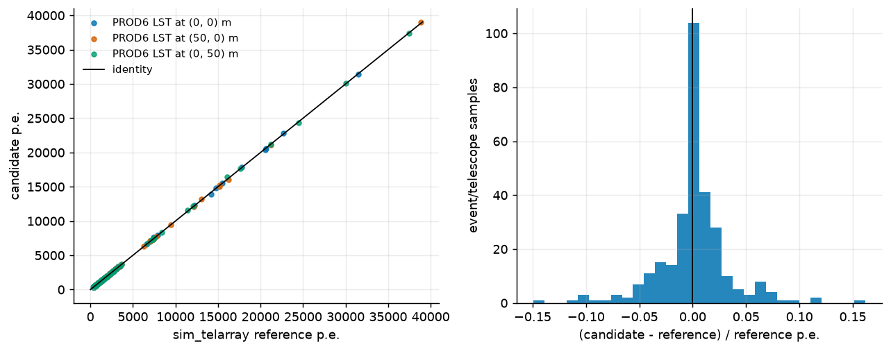
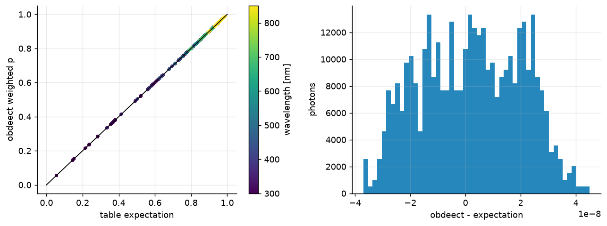
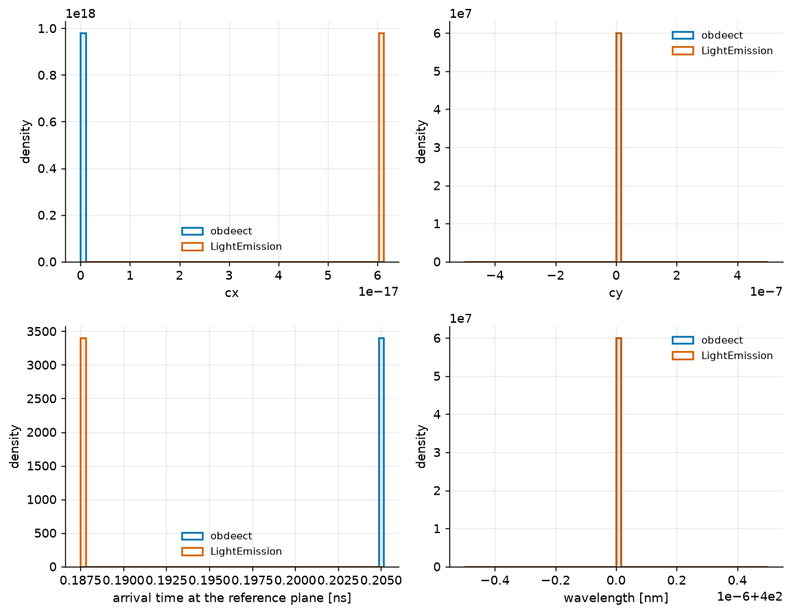
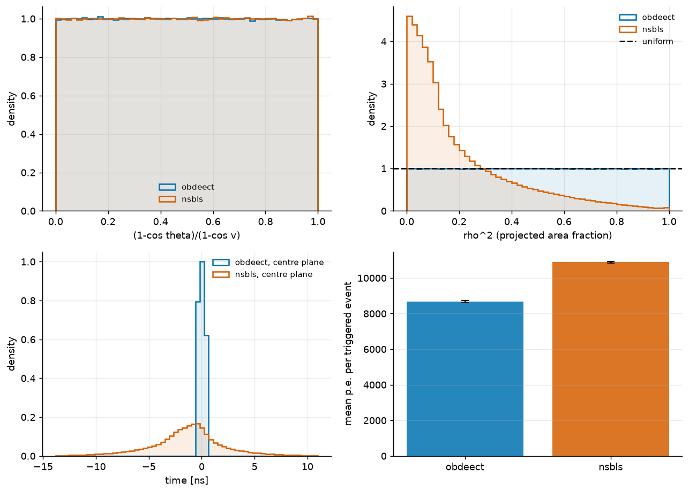
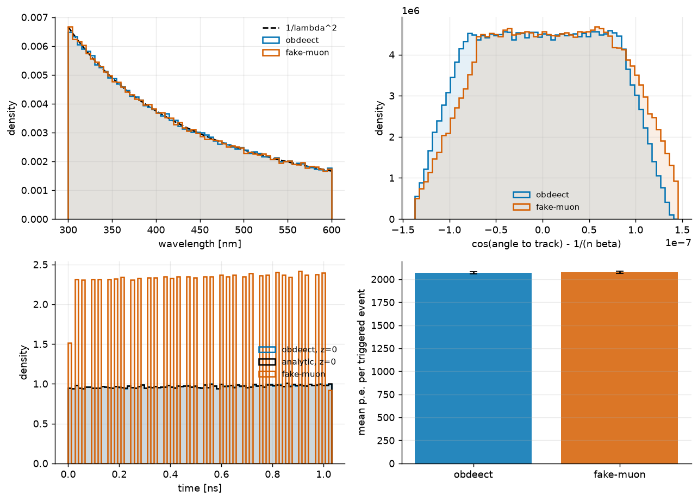
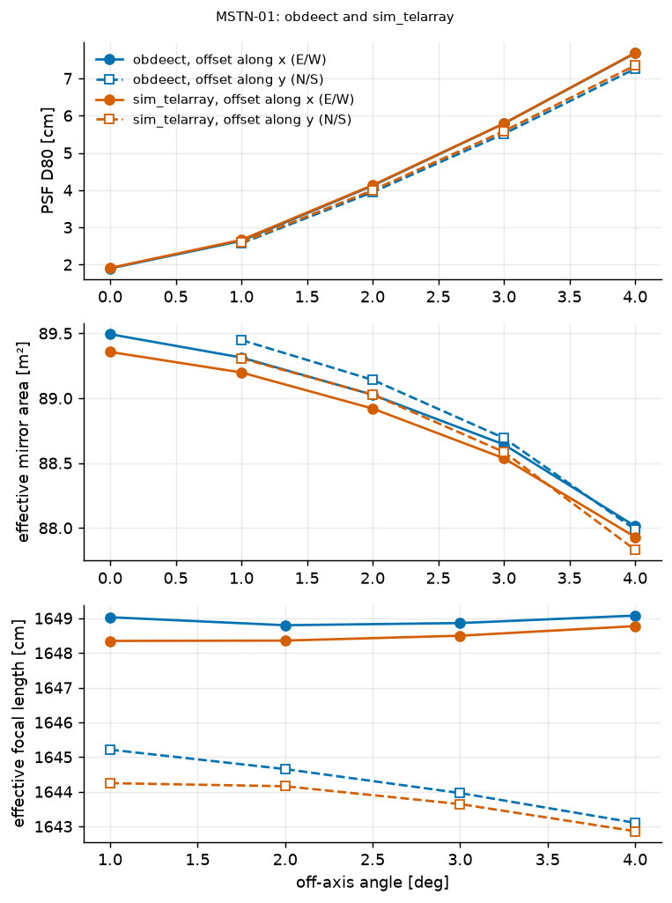
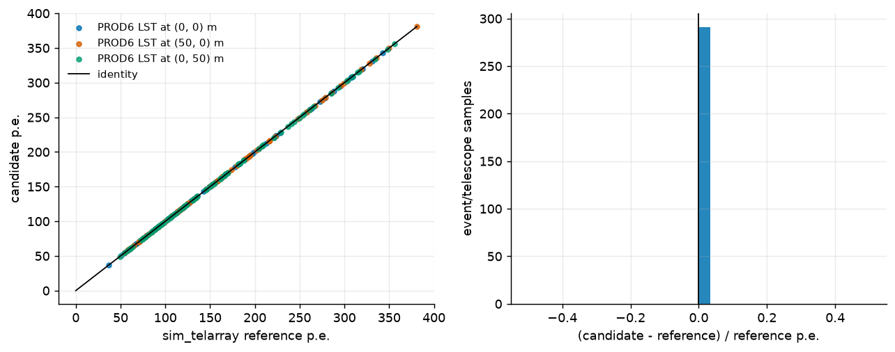
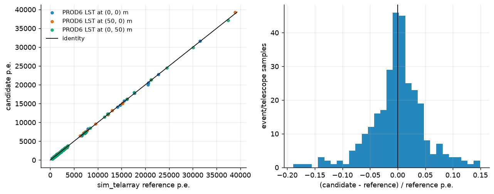
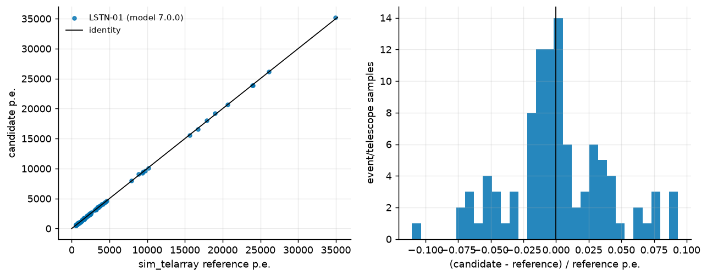

# obdeect versus sim_telarray, 2026-11-14

<!-- notes:intro -->
Run: `bash obdeect-validation/containers/run-validation.sh full obdeect-validation/results/full-7.0.0`
(suite `full`, 19 cases) in the simtools-prod based container; obdeect `0.8.1.dev52+g6721ba04b`,
sim_telarray v2025-11-30-rc, simulation models 7.0.0 for all cases (optics and chain). Wall time
908 s. Supersedes the earlier 2026-11-14 run that used models 6.0.2 for optics.

Change against the 6.0.2 run (same cases, same limits):

- Optics: numbers differ per telescope; all within the provisional limits (LST D80 0.53 %, MST
  1.32 %, SST area 0.33 % vs 0.39 % before).
- Stream, chain (atmosphere and optics) and propagation: unchanged within the printed precision,
  except the sim_telarray table error (0 → 4.5e-8, still well inside tolerance).
- Sources: camera p.e. ratios moved by about 0.5–1 % (flasher dish 1.0019 → 1.0013; point source
  0.999 → 1.010; flasher secondary 0.996 → 1.001; muon track 0.981 → 0.997). Night sky unchanged
  (0.80). The cause was not isolated: obdeect moved from `0.8.1.dev31` to `dev52` as well as the model.
<!-- /notes -->

**Result: 19 PASS** (suite `full`, status PASS). Each case below shows what is compared, its headline numbers and figures; all metrics are in the case's `metrics.json`, limits and settings in `details.json`.

| Step | Case | Headline | Verdict |
|---|---|---|---|
| 1. Photon stream format | [LED stream → sim_telarray EventIO, strict reader](#stream-led-eventio) | photons 60 / 60, block order as CORSIKA: 1 | PASS |
| 1. Photon stream format | [CORSIKA → stream → sim_telarray](#stream-corsika-roundtrip) | p.e. +0.07% ± 0.09%, 0 trigger mismatches | PASS |
| 2. Atmosphere (propagation) | [Extinction vs analytic Beer–Lambert](#propagation-extinction-analytic) | largest transmission error 0.0e+00 | PASS |
| 2. Atmosphere (propagation) | [Extinction vs sim_telarray tables](#propagation-extinction-simtel-table) | largest error 4.5e-08 | PASS |
| 2. Atmosphere (propagation) | [Refraction and timing vs CORSIKA atmo](#propagation-atmosphere-corsika) | displacement 4.4e-04 m, time 1.6e-03 ns | PASS |
| 3. Light sources | [LED vs pixled](#sources-led-reference) | photons 60 / 60 | PASS |
| 3. Light sources | [Flasher on the dish vs ff-1m](#sources-flasher-dish) | photons 1.0015 ± 0.0008, camera p.e. 1.0013 ± 0.0019 | PASS |
| 3. Light sources | [Flasher via secondary mirror vs ff-gct](#sources-flasher-secondary) | photons 1.0002 ± 0.0022, time +0.008 ns, camera p.e. 1.001 ± 0.006 | PASS |
| 3. Light sources | [Point source vs xyzls](#sources-point-source) | accepted photons 0.995 ± 0.012, time +0.004 ns, camera p.e. 1.010 ± 0.010 | PASS |
| 3. Light sources | [Beam scan vs xyls](#sources-beam-scan) | photons 1.000 ± 0.006 | PASS |
| 3. Light sources | [Laser beam geometry vs ls-beam](#sources-laser-beam) | path 131.60 vs 131.65 m | PASS |
| 3. Light sources | [Night sky vs analytic and nsbls](#sources-night-sky) | rate error 9.2e-08, area-uniform KS 0.0006, camera p.e. vs nsbls 0.80 (recorded only) | PASS |
| 3. Light sources | [Muon track vs fake-muon and analytic](#sources-muon-track) | yield 1.0003 ± 0.0029, time vs analytic -1.1e-05 ns, camera p.e. 0.997 ± 0.009 | PASS |
| 4. Telescope optics | [Optics lst-7.0.0](#optics-lst-7-0-0) | D80 ≤ 0.53%, area ≤ 0.09%, focal length ≤ 0.018% | PASS |
| 4. Telescope optics | [Optics mst-7.0.0](#optics-mst-7-0-0) | D80 ≤ 1.32%, area ≤ 0.18%, focal length ≤ 0.059% | PASS |
| 4. Telescope optics | [Optics sst-7.0.0](#optics-sst-7-0-0) | D80 ≤ 0.13%, area ≤ 0.33%, focal length ≤ 0.010% | PASS |
| 5. Full chain | [Near-threshold showers (20–100 GeV), stream round trip](#chain-stream-roundtrip-threshold) | 291 telescope events, p.e. +0.00%, 0 trigger mismatches | PASS |
| 5. Full chain | [obdeect atmosphere + sim_telarray optics and camera](#chain-atmosphere-substitution) | p.e. +0.12% ± 0.15%, image χ² 1.12 | PASS |
| 5. Full chain | [obdeect atmosphere and optics + sim_telarray camera](#chain-optics-bypass1) | p.e. +0.06% ± 0.19%, image χ² 0.99, 0 trigger mismatches | PASS |

## How to read this report

**What is compared.** Each case compares obdeect with a reference: an analytic expectation, a sim_telarray, LightEmission or CORSIKA program, or both. Signed values are obdeect / reference − 1, ratios are obdeect / reference, ± is one standard error.

**What PASS means.** All gated checks of the case are inside limits fixed before the run (`details.json`). Where a reference program is known to be wrong, the case is gated against the analytic expectation, and the comparison with that program is *recorded only*: shown, but not part of the verdict.

**Same frame before comparing.** obdeect light sources write photons where they are emitted, the LightEmission programs where they arrive. Before comparing, obdeect photons are moved to the reference plane (flight time added). The time panels show the arrival times as compared.

**Known features of the reference programs.** Some differences in the plots come from the reference, not from obdeect; each affected case has an *Expected differences* box under its figure.

- ff-1m, ff-gct and fake-muon write times in steps of 1/32 ns: their time histograms show spikes or a comb, obdeect times are continuous. Means and widths are compared.
- nsbls samples the photon entry point wrongly (radius `1 − sqrt(u)` instead of `sqrt(u)`, rotated azimuth): its entry-point, time and camera distributions differ from the analytic expectation, which obdeect follows.
- fake-muon times deviate slightly from the analytic distribution; obdeect follows it.

**Image χ²/ndf (chain cases).** Camera images of the same event and telescope from the two runs, pixel by pixel: mean over pixels with signal of (a − b)² / (a + b), with a, b the photoelectrons of the pixel in each run. Differences from Poisson fluctuations alone give about 1; systematic shape differences give more (limit 2). Values below 1 mean the two runs share part of their fluctuations (e.g. identical photons in the stream round trip). For light sources the summed images are compared the same way (χ² per pixel of the normalised images).

**KS.** Largest difference of two cumulative distributions, compared with the critical value for the sample sizes (in brackets where shown).

**Optics.** The star is moved off axis along x (E/W) and along y (N/S). The optics are not rotationally symmetric, so off axis the two directions give different values; each figure shows both, and both programs must agree for each direction.

## 1. Photon stream format

The obdeect photon stream must carry CORSIKA photons and light-source photons to sim_telarray without loss: CORSIKA → stream → sim_telarray EventIO, compared with sim_telarray on the original CORSIKA file.

<!-- notes:stream -->

<!-- /notes -->

### LED stream → sim_telarray EventIO, strict reader — PASS

Case: LED light-source stream to sim_telarray EventIO, read by the independent eventio reader

An LED light-source stream is converted to sim_telarray EventIO and read back with the independent `eventio` reader.

| Quantity | Value |
|---|---|
| Events (stream / EventIO) | 3 / 3 |
| Photons (stream / EventIO) | 60 / 60 |
| Block order as CORSIKA (1 = yes) | 1 |

`stream.led-eventio`: 9/9 gated checks pass. [metrics.json](stream.led-eventio/metrics.json) · [details.json](stream.led-eventio/details.json)

### CORSIKA → stream → sim_telarray — PASS

Case: CORSIKA IACT -> obdeect stream -> sim_telarray IACT, bunch and camera comparison, plus stream command variants

CORSIKA IACT file → `obdeect stream from-corsika` → `obdeect stream to-simtel` → sim_telarray, against sim_telarray on the CORSIKA file. Also checks the stdin, cat and tee variants. Array: three PROD6 LSTs (sim_telarray `CTA-PROD6-LST.cfg`, not the simulation-models release) at the CTAO-North altitude of 2156 m, at x, y = (0, 0), (50, 0) and (0, 50) m; gamma showers at 20° zenith.

| Quantity | Value |
|---|---|
| Telescope events compared | 300 |
| Camera p.e. bias | +0.07% ± 0.09% |
| Trigger mismatches | 0 |
| Bunch count difference | 0 |
| Largest codec error (in units of the codec bound) | 0.076 |

`stream.corsika-roundtrip`: 14/14 gated checks pass. [metrics.json](stream.corsika-roundtrip/metrics.json) · [details.json](stream.corsika-roundtrip/details.json)

*Camera p.e. per telescope event, colour per telescope (type and position in the legend): round trip against direct sim_telarray (left), relative difference (right).*

## 2. Atmosphere (propagation)

obdeect propagation (extinction, refraction, travel time) against analytic results, sim_telarray's extinction tables and the compiled CORSIKA atmosphere code.

<!-- notes:propagation -->

<!-- /notes -->

### Extinction vs analytic Beer–Lambert — PASS

Case: Beer-Lambert constant optical depth (analytic reference)

Atmospheric transmission for an exponential atmosphere against the analytic Beer–Lambert result, zenith 0–60°.

| Quantity | Value |
|---|---|
| Samples | 16 |
| Largest transmission error | 0.0e+00 |

`propagation.extinction-analytic`: 2/2 gated checks pass. [metrics.json](propagation.extinction-analytic/metrics.json)

*Transmission of obdeect and the analytic expectation.*

### Extinction vs sim_telarray tables — PASS

Case: Real sim_telarray transmission table, telescope path and thinning

Extinction from a sim_telarray optical-depth table against sim_telarray's own interpolation, for wavelengths, heights, zenith angles, telescope elevations and in-telescope path lengths; weighted and thinned modes.

| Quantity | Value |
|---|---|
| Grid (wavelengths × heights × zeniths) | 9 × 5 × 4 |
| Largest error (weighted mode) | 4.5e-08 |
| Largest error (in-telescope depth) | 4.3e-19 |
| Thinned count residual | 2.77 σ |

`propagation.extinction-simtel-table`: 10/10 gated checks pass. [metrics.json](propagation.extinction-simtel-table/metrics.json)

*Weighted transmission of obdeect against the sim_telarray table.*

### Refraction and timing vs CORSIKA atmo — PASS

Case: Atmosphere refraction against compiled CORSIKA IACT/atmo

Refraction and travel time against the compiled CORSIKA atmosphere code (atmo.c) for emission heights 3–20 km and zenith 0–60°.

| Quantity | Value |
|---|---|
| Samples (bent) | 24 (24) |
| Largest displacement error | 4.4e-04 m |
| Largest travel-time error | 1.6e-03 ns |
| Largest direction-cosine error | 1.6e-12 |

`propagation.atmosphere-corsika`: 5/5 gated checks pass. [metrics.json](propagation.atmosphere-corsika/metrics.json)

*obdeect − CORSIKA: direction cosine, displacement and travel time against emission height, per zenith angle.*

## 3. Light sources

obdeect light sources against the sim_telarray LightEmission programs and analytic expectations: photon yield, directions, times and wavelengths at emission, then camera photoelectrons in sim_telarray. Signed values are obdeect / reference − 1; ratios are obdeect / reference.

<!-- notes:sources -->
Reference findings (recorded, not judged; details in each `details.json`):

- fake-muon: arrival-time distribution differs from the analytic one by KS 0.021 (mean −5 ps).
- nsbls: entry radius `1 − sqrt(u)` instead of `sqrt(u)` (flux not isotropic, too much light
  at the dish centre), and the entry point is rotated with the azimuth of `d` instead of `−d`
  (`IactLightEmission.cc` ~l.1395), which breaks impact parameters and times. The night-sky camera
  ratio (0.80) is therefore recorded only, not gated; with the same sampler in both programs
  (2026-11-13 run) it was 0.998 ± 0.009.
- ff-gct: near-horizontal photons (|cz| < 0.3) carry a refraction time term of up to 4 ns.
- sim_telarray skips an event block larger than its input buffer (default limits) and still
  exits 0; the flasher-secondary camera stage therefore uses 1e6 photons per flasher. Not an
  obdeect format problem: with `CORSIKA_IO_BUFFER=2GiB MAX_BUNCHES=50000000` the 1.28 GB
  stream is read completely (568833 p.e., 10x the 1e6 run).
- Point source: the raw photon ratio is recorded but not gated; the gated quantity is the
  accepted-photon ratio.
<!-- /notes -->

### LED vs pixled — PASS

Case: sources.led-reference

LED in the camera against the pixled reference program: identical photons expected.

| Quantity | Value |
|---|---|
| Photons (obdeect / reference) | 60 / 60 |
| Largest per-event photon difference | 0.0 |
| Position centroid difference | 1.05e-08 cm |

`sources.led-reference`: 8/8 gated checks pass. [metrics.json](sources.led-reference/metrics.json) · [details.json](sources.led-reference/details.json)

### Flasher on the dish vs ff-1m — PASS

Case: Dish flasher versus ff-1m (emission; camera stage in details.json)

Flasher on the dish axis against ff-1m: emission (stage 1), then camera photoelectrons through sim_telarray (stage 2).

| Quantity | Value |
|---|---|
| Photons per event | 1.0015 ± 0.0008 |
| Direction mean cx / cy | +0.62 σ / -0.66 σ |
| Arrival time mean (after frame correction) | -0.006 ± 0.000 ns |
| Camera p.e. | 1.0013 ± 0.0019 |
| Camera image χ²/ndf | 1.03 |

`sources.flasher-dish`: 14/14 gated checks pass. [metrics.json](sources.flasher-dish/metrics.json) · [details.json](sources.flasher-dish/details.json)

*Emission: direction cosines, arrival time at the reference plane (obdeect times moved to the plane, as in the metrics) and wavelength of obdeect and LightEmission photons.*

> **Expected differences.** Time panel: ff-1m writes times in steps of 1/32 ns, so its histogram is a row of spikes; obdeect times are continuous. Both cover the same window; the mean difference is -0.006 ns (limit 0.05 ns). Wavelength: both are monochromatic.

### Flasher via secondary mirror vs ff-gct — PASS

Case: Secondary flasher versus ff-gct (stage 1 emission)

Flashers at the camera corners, light reflected by the secondary mirror, against ff-gct; camera photoelectrons through sim_telarray.

| Quantity | Value |
|---|---|
| Photons per event | 1.0002 ± 0.0022 |
| Arrival time mean | +0.008 ± 0.003 ns |
| Camera p.e. | 1.0014 ± 0.0059 |
| Camera image χ²/ndf | 1.08 |

`sources.flasher-secondary`: 12/12 gated checks pass. [metrics.json](sources.flasher-secondary/metrics.json) · [details.json](sources.flasher-secondary/details.json)

*Emission: direction cosines, arrival time at the reference plane (obdeect times moved to the plane, as in the metrics) and wavelength of obdeect and LightEmission photons.*

> **Expected differences.** Time panel: ff-gct writes times in steps of 1/32 ns, so its histogram has regular spikes on the same falling distribution; obdeect times are continuous. Mean difference +0.008 ns (limit 0.05 ns). Times are compared with the ff-gct time model: photons with |cz| ≥ 0.3 within the camera radius on both sides.

### Point source vs xyzls — PASS

Case: Point source versus xyzls (emission; camera stage in details.json)

Isotropic point source at a distance against xyzls; photons accepted by the telescope and camera photoelectrons.

| Quantity | Value |
|---|---|
| Accepted photons (gated) | 0.995 ± 0.012 |
| Raw photons (recorded only) | 1.039 ± 0.001 |
| Arrival time mean | +0.004 ± 0.001 ns |
| Camera p.e. | 1.010 ± 0.010 |

`sources.point-source`: 14/14 gated checks pass. [metrics.json](sources.point-source/metrics.json) · [details.json](sources.point-source/details.json)

*Emission: direction cosines, arrival time at the reference plane (obdeect times moved to the plane, as in the metrics) and wavelength of obdeect and LightEmission photons.*

### Beam scan vs xyls — PASS

Case: Beam scan versus xyls (emission; camera stage in details.json)

Scanning laser beam against the LightEmission beam program.

| Quantity | Value |
|---|---|
| Photons per event | 1.000 ± 0.006 |
| Direction mean cx / cy | +0.00 σ / +0.00 σ |

`sources.beam-scan`: 12/12 gated checks pass. [metrics.json](sources.beam-scan/metrics.json) · [details.json](sources.beam-scan/details.json)

*Emission: direction cosines, arrival time at the reference plane (obdeect times moved to the plane, as in the metrics) and wavelength of obdeect and LightEmission photons.*

### Laser beam geometry vs ls-beam — PASS

Case: Laser beam versus ls-beam: FoV crossing geometry only (yield, direction, time, camera BLOCKED)

Laser beam geometry against ls-beam: where the beam enters and leaves the telescope field of view.

| Quantity | Value |
|---|---|
| Path in the field of view (obdeect / reference) | 131.60 / 131.65 m |
| Entry / exit offset | 0.00 / 0.05 m |

`sources.laser-beam`: 6/6 gated checks pass. [metrics.json](sources.laser-beam/metrics.json) · [details.json](sources.laser-beam/details.json)

*Beam path of obdeect and ls-beam relative to the field of view.*

### Night sky vs analytic and nsbls — PASS

Case: Night sky versus nsbls: yield, rate, direction, projected area, time, camera p.e.

Night-sky background source against the analytic flux and nsbls; camera photoelectrons through sim_telarray.

| Quantity | Value |
|---|---|
| Rate, relative error vs configured | 9.2e-08 |
| Area-uniform entry (KS, critical) | 0.0006 (0.0011) |
| Flat pulse (KS, critical) | 0.0006 (0.0011) |
| Camera p.e. vs nsbls (recorded only) | 0.796 ± 0.007 |

`sources.night-sky`: 12/12 gated checks pass. [metrics.json](sources.night-sky/metrics.json) · [details.json](sources.night-sky/details.json)

*Angular distribution in the cone, projected entry point (uniform expected), time at the centre plane, and camera p.e. per triggered event.*

> **Expected differences.** The nsbls curves differ because nsbls is wrong, not obdeect. Projected entry point (top right): an isotropic flux is flat in ρ²; obdeect is flat (KS 0.0006, critical 0.0011), nsbls piles up at the centre (KS 0.45) because it draws the radius as 1 − sqrt(u) instead of sqrt(u) and rotates the entry point with the wrong azimuth (`IactLightEmission.cc` ~l.1395). Time (bottom left): the wrong entry points give nsbls a spread of 3.6 ns; obdeect has the configured pulse (0.29 ns). Camera (bottom right): nsbls puts more light on the dish centre, so its camera sees more; obdeect / nsbls = 0.80, recorded only. With the nsbls sampler in obdeect (2026-11-13 report) the camera ratio was 0.998 ± 0.009.

### Muon track vs fake-muon and analytic — PASS

Case: Muon track versus fake-muon: yield, Cherenkov angle, spectrum, time, camera p.e.

Muon track against fake-muon and the analytic Cherenkov expectation; camera photoelectrons through sim_telarray.

| Quantity | Value |
|---|---|
| Photon yield (obdeect / fake-muon) | 1.0003 ± 0.0029 |
| Time vs analytic | -1.1e-05 ns, KS 0.0002 |
| Camera p.e. | 0.997 ± 0.009 |

`sources.muon-track`: 18/18 gated checks pass. [metrics.json](sources.muon-track/metrics.json) · [details.json](sources.muon-track/details.json)

*Wavelength against 1/λ², Cherenkov angle residual, arrival time against the analytic distribution (black), and camera p.e. per triggered event.*

> **Expected differences.** Time (bottom left): fake-muon writes times in steps of 1/32 ns (comb); obdeect follows the analytic distribution (black; mean difference -1.1e-05 ns, KS 0.0002, critical 0.0056). Cherenkov angle (top right): the edges differ by about 1e-7 in cos θ, far below what an image resolves. Wavelength and camera p.e. agree.

## 4. Telescope optics

Ray tracing of obdeect against sim_telarray for the same telescope model, star light at 0–4° off axis along two directions: PSF (D80), effective mirror area and effective focal length.

<!-- notes:optics -->

<!-- /notes -->

### Optics lst-7.0.0 — PASS

Case: Optics LSTN-01 (model 7.0.0): simtools sim_telarray vs obdeect, offsets 0-4 deg, N/E

sim_telarray ray tracing (via simtools) against obdeect for the same telescope model: a star at 10 km, 0–4° off axis, moved along x (E/W) and along y (N/S). PSF (D80), effective mirror area and effective focal length per offset.

| Quantity | Value |
|---|---|
| Offsets | 9 |
| Largest PSF (D80) difference | 0.53% |
| Largest effective area difference | 0.09% |
| Largest effective focal length difference | 0.018% |

`optics.lst-7.0.0`: 5/5 gated checks pass. [metrics.json](optics.lst-7.0.0/metrics.json) · [details.json](optics.lst-7.0.0/details.json)

*obdeect (blue) and sim_telarray (orange) against off-axis angle; filled circles and solid lines: star offset along x (E/W), open squares and dashed lines: along y (N/S). On axis there is one point.*

*obdeect / sim_telarray − 1 against off-axis angle, per offset direction; shaded band = provisional limit.*

Plots written by simtools (one program each): [obdeect/validate_optics_LSTN-01_eff_area.png](optics.lst-7.0.0/obdeect/validate_optics_LSTN-01_eff_area.png) · [obdeect/validate_optics_LSTN-01_eff_flen.png](optics.lst-7.0.0/obdeect/validate_optics_LSTN-01_eff_flen.png) · [obdeect/validate_optics_LSTN-01_psf_cm.png](optics.lst-7.0.0/obdeect/validate_optics_LSTN-01_psf_cm.png) · [obdeect/validate_optics_LSTN-01_psf_deg.png](optics.lst-7.0.0/obdeect/validate_optics_LSTN-01_psf_deg.png) · [sim_telarray/validate_optics_LSTN-01_eff_area.png](optics.lst-7.0.0/sim_telarray/validate_optics_LSTN-01_eff_area.png) · [sim_telarray/validate_optics_LSTN-01_eff_flen.png](optics.lst-7.0.0/sim_telarray/validate_optics_LSTN-01_eff_flen.png) · [sim_telarray/validate_optics_LSTN-01_psf_cm.png](optics.lst-7.0.0/sim_telarray/validate_optics_LSTN-01_psf_cm.png) · [sim_telarray/validate_optics_LSTN-01_psf_deg.png](optics.lst-7.0.0/sim_telarray/validate_optics_LSTN-01_psf_deg.png)

### Optics mst-7.0.0 — PASS

Case: Optics MSTN-01 (model 7.0.0): simtools sim_telarray vs obdeect, offsets 0-4 deg, N/E

sim_telarray ray tracing (via simtools) against obdeect for the same telescope model: a star at 10 km, 0–4° off axis, moved along x (E/W) and along y (N/S). PSF (D80), effective mirror area and effective focal length per offset.

| Quantity | Value |
|---|---|
| Offsets | 9 |
| Largest PSF (D80) difference | 1.32% |
| Largest effective area difference | 0.18% |
| Largest effective focal length difference | 0.059% |

`optics.mst-7.0.0`: 5/5 gated checks pass. [metrics.json](optics.mst-7.0.0/metrics.json) · [details.json](optics.mst-7.0.0/details.json)

*obdeect (blue) and sim_telarray (orange) against off-axis angle; filled circles and solid lines: star offset along x (E/W), open squares and dashed lines: along y (N/S). On axis there is one point.*

*obdeect / sim_telarray − 1 against off-axis angle, per offset direction; shaded band = provisional limit.*

Plots written by simtools (one program each): [obdeect/validate_optics_MSTN-01_eff_area.png](optics.mst-7.0.0/obdeect/validate_optics_MSTN-01_eff_area.png) · [obdeect/validate_optics_MSTN-01_eff_flen.png](optics.mst-7.0.0/obdeect/validate_optics_MSTN-01_eff_flen.png) · [obdeect/validate_optics_MSTN-01_psf_cm.png](optics.mst-7.0.0/obdeect/validate_optics_MSTN-01_psf_cm.png) · [obdeect/validate_optics_MSTN-01_psf_deg.png](optics.mst-7.0.0/obdeect/validate_optics_MSTN-01_psf_deg.png) · [sim_telarray/validate_optics_MSTN-01_eff_area.png](optics.mst-7.0.0/sim_telarray/validate_optics_MSTN-01_eff_area.png) · [sim_telarray/validate_optics_MSTN-01_eff_flen.png](optics.mst-7.0.0/sim_telarray/validate_optics_MSTN-01_eff_flen.png) · [sim_telarray/validate_optics_MSTN-01_psf_cm.png](optics.mst-7.0.0/sim_telarray/validate_optics_MSTN-01_psf_cm.png) · [sim_telarray/validate_optics_MSTN-01_psf_deg.png](optics.mst-7.0.0/sim_telarray/validate_optics_MSTN-01_psf_deg.png)

### Optics sst-7.0.0 — PASS

Case: Optics SSTS-01 (dual mirror) (model 7.0.0): simtools sim_telarray vs obdeect, offsets 0-4 deg, N/E

sim_telarray ray tracing (via simtools) against obdeect for the same telescope model: a star at 10 km, 0–4° off axis, moved along x (E/W) and along y (N/S). PSF (D80), effective mirror area and effective focal length per offset.

| Quantity | Value |
|---|---|
| Offsets | 9 |
| Largest PSF (D80) difference | 0.13% |
| Largest effective area difference | 0.33% |
| Largest effective focal length difference | 0.010% |

`optics.sst-7.0.0`: 5/5 gated checks pass. [metrics.json](optics.sst-7.0.0/metrics.json) · [details.json](optics.sst-7.0.0/details.json)

*obdeect (blue) and sim_telarray (orange) against off-axis angle; filled circles and solid lines: star offset along x (E/W), open squares and dashed lines: along y (N/S). On axis there is one point.*

*obdeect / sim_telarray − 1 against off-axis angle, per offset direction; shaded band = provisional limit.*

Plots written by simtools (one program each): [obdeect/validate_optics_SSTS-01_eff_area.png](optics.sst-7.0.0/obdeect/validate_optics_SSTS-01_eff_area.png) · [obdeect/validate_optics_SSTS-01_eff_flen.png](optics.sst-7.0.0/obdeect/validate_optics_SSTS-01_eff_flen.png) · [obdeect/validate_optics_SSTS-01_psf_cm.png](optics.sst-7.0.0/obdeect/validate_optics_SSTS-01_psf_cm.png) · [obdeect/validate_optics_SSTS-01_psf_deg.png](optics.sst-7.0.0/obdeect/validate_optics_SSTS-01_psf_deg.png) · [sim_telarray/validate_optics_SSTS-01_eff_area.png](optics.sst-7.0.0/sim_telarray/validate_optics_SSTS-01_eff_area.png) · [sim_telarray/validate_optics_SSTS-01_eff_flen.png](optics.sst-7.0.0/sim_telarray/validate_optics_SSTS-01_eff_flen.png) · [sim_telarray/validate_optics_SSTS-01_psf_cm.png](optics.sst-7.0.0/sim_telarray/validate_optics_SSTS-01_psf_cm.png) · [sim_telarray/validate_optics_SSTS-01_psf_deg.png](optics.sst-7.0.0/sim_telarray/validate_optics_SSTS-01_psf_deg.png)

## 5. Full chain

obdeect stages inserted into the CORSIKA → sim_telarray chain, compared event by event with the direct sim_telarray run on the same showers and seeds. Bias = obdeect / reference − 1 of camera photoelectrons, with its standard error.

<!-- notes:chain -->

<!-- /notes -->

### Near-threshold showers (20–100 GeV), stream round trip — PASS

Case: Near-threshold CORSIKA showers (20-100 GeV): stream round trip and sim_telarray camera

Stream round trip for near-threshold showers (20–100 GeV), where single photons decide the trigger. Array: three PROD6 LSTs (sim_telarray `CTA-PROD6-LST.cfg`, not the simulation-models release) at the CTAO-North altitude of 2156 m, at x, y = (0, 0), (50, 0) and (0, 50) m; gamma showers at 20° zenith.

| Quantity | Value |
|---|---|
| Telescope events compared | 291 |
| Camera p.e. bias | +0.00% ± 0.00% |
| Trigger mismatches | 0 |

`chain.stream-roundtrip-threshold`: 6/6 gated checks pass. [metrics.json](chain.stream-roundtrip-threshold/metrics.json) · [details.json](chain.stream-roundtrip-threshold/details.json)

*Camera p.e. per telescope event, colour per telescope (type and position in the legend): round trip against direct sim_telarray (left), relative difference (right).*

### obdeect atmosphere + sim_telarray optics and camera — PASS

Case: obdeect atmosphere substitution vs sim_telarray atmosphere (20 deg, CORSIKA band)

obdeect atmosphere (extinction) replaces sim_telarray's: CORSIKA → obdeect propagation → sim_telarray with a zero optical-depth table, against sim_telarray with its own table. Array: three PROD6 LSTs (sim_telarray `CTA-PROD6-LST.cfg`, not the simulation-models release) at the CTAO-North altitude of 2156 m, at x, y = (0, 0), (50, 0) and (0, 50) m; gamma showers at 20° zenith.

| Quantity | Value |
|---|---|
| Telescope events compared | 300 |
| Camera p.e. bias | +0.12% ± 0.15% |
| Image χ²/ndf | 1.12 |
| Trigger mismatches | 0.0 |

`chain.atmosphere-substitution`: 12/12 gated checks pass. [metrics.json](chain.atmosphere-substitution/metrics.json) · [details.json](chain.atmosphere-substitution/details.json)

*Camera p.e. per telescope event, colour per telescope (type and position in the legend): obdeect atmosphere against sim_telarray's (left), relative difference (right).*

### obdeect atmosphere and optics + sim_telarray camera — PASS

Case: CORSIKA -> obdeect trace-stream -> sim_telarray camera (Bypass_Optics=1) vs direct sim_telarray, matched LSTN-01 7.0.0 model, unit atmosphere

obdeect atmosphere and optics replace sim_telarray's: CORSIKA → obdeect propagation → obdeect trace-stream → sim_telarray camera only, against the direct sim_telarray run. Telescope: one LSTN-01, simulation models 7.0.0, CTAO-North, from the configuration simtools generates; gamma showers at 20° zenith.

| Quantity | Value |
|---|---|
| Telescope events compared | 100 |
| Camera p.e. bias | +0.06% ± 0.19% |
| Image χ²/ndf | 0.99 |
| Mean arrival-time difference | +0.022 ns |
| Trigger mismatches | 0 |

`chain.optics-bypass1`: 6/6 gated checks pass. [metrics.json](chain.optics-bypass1/metrics.json) · [details.json](chain.optics-bypass1/details.json)

*Camera p.e. per telescope event, colour per telescope (type and position in the legend): obdeect chain against direct sim_telarray (left), relative difference (right).*

## Scope and limits

<!-- notes:end -->
Limits are set before the runs and recorded in each `details.json`; optics and source limits
are provisional and need scientific approval.

Not covered: `Bypass_Optics=3` (not in the sim_telarray release used here; implemented on the
sim_telarray branch `bypass-obdeect-mode-3`, in review), dual-mirror shower chain, scattered
laser light, zenith angles other than 20° in the shower chain, per-mirror and incident-angle
optics cases.
<!-- /notes -->
