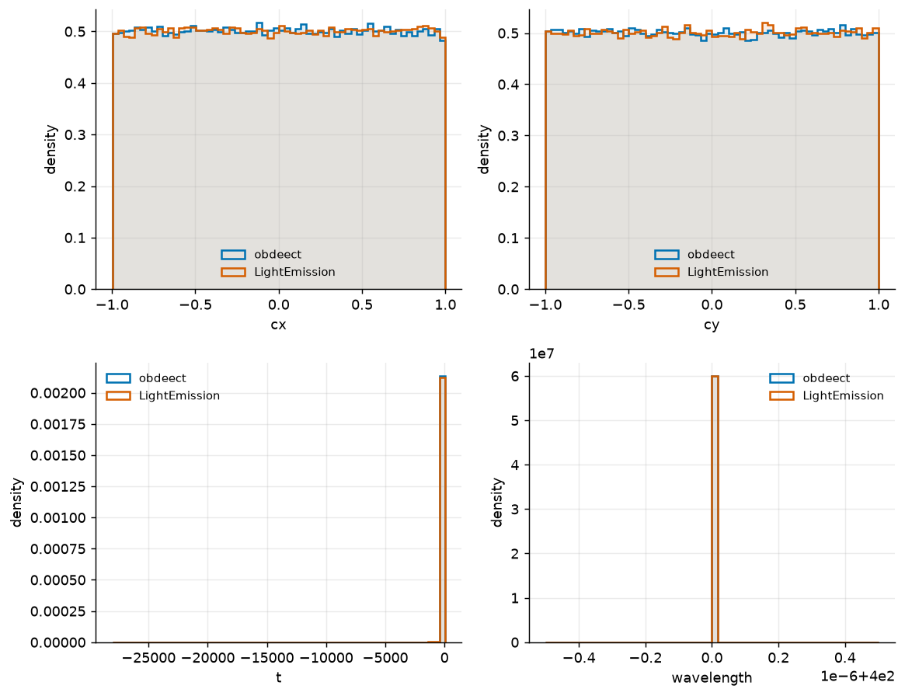

# obdeect versus sim_telarray, 2026-11-14

Run: `obdeect-validate run --suite suites/full.json --environment environments/workspace.json`
in the simtools-prod based container; obdeect `0.8.1.dev31+g320a6e74b` with the INPUTCFG-order
and night-sky sampler fixes (stream and sources packages), sim_telarray v2025-11-30-rc, models
6.0.2 (optics) and 7.0.0 (chain). Each case directory holds `metrics.json`, `details.json`
(limits, parameter mapping, reference findings) and its figure. Signed values are
obdeect / reference − 1. Supersedes 2026-11-13.

**Result: 18 PASS, 1 FAIL as run.** The failure is the night-sky camera ratio against nsbls, which
uses a non-isotropic entry-point sampler (see below). After this run the night-sky camera ratio
was made recorded-only (it is no longer a required metric); the suite was not rerun, so the
table below still shows the run as executed.

| Stage | Case | Agreement | Verdict |
|---|---|---|---|
| Stream | CORSIKA → stream → sim_telarray | 300 telescope events: p.e. +0.07 ± 0.09 %, 0 trigger mismatches | PASS |
| Stream | near-threshold showers (20–100 GeV) | 97 events identical, 0 trigger mismatches | PASS |
| Stream | LED stream → EventIO, strict reader | block order RUNH, INPUTCFG, TELPOS as CORSIKA; 3/3 events, 60/60 photons | PASS |
| Propagation | analytic Beer–Lambert, 0–60° | max transmission error 0 | PASS |
| Propagation | sim_telarray extinction tables | max error 0 | PASS |
| Propagation | refraction/timing vs compiled CORSIKA atmo | displacement 0.44 mm, time 1.6 ps | PASS |
| Chain | obdeect atmosphere + sim_telarray camera | 300 telescope events: p.e. +0.12 ± 0.15 %, image χ² 1.12 | PASS |
| Optics | LST / MST / SST, 0–4° | D80 ≤ 0.5 / 1.3 / 0.1 %, area ≤ 0.09 / 0.18 / 0.39 %, focal length ≤ 0.06 % | PASS |
| Chain | obdeect optics + sim_telarray camera (Bypass_Optics=1), LSTN-01 7.0.0 | 100 events: p.e. +0.06 ± 0.19 %, image χ² 0.99, time +0.02 ns | PASS |
| Sources | LED, beam scan, laser geometry | exact / exact / path 131.60 vs 131.65 m | PASS |
| Sources | flasher dish vs ff-1m | camera p.e. 1.0019 ± 0.0015, χ² 0.93 | PASS |
| Sources | point source vs xyzls | accepted photons 0.992 ± 0.012; time +0.006 ± 0.001 ns (air delay included); camera p.e. 0.999 ± 0.006 | PASS |
| Sources | flasher secondary vs ff-gct | photons 1.0001 ± 0.0022; time +0.006 ± 0.003 ns, RMS 1.092 vs 1.092 ns (\|cz\| ≥ 0.3); camera p.e. 0.996 ± 0.006 | PASS |
| Sources | muon track vs fake-muon and analytic | yield 1.0003; time vs analytic 0.000 ns, KS 0.0002; vs fake-muon +0.005 ns; camera p.e. 0.981 ± 0.009 | PASS |
| Sources | night sky vs analytic and nsbls | rate exact; area-uniform entry KS 0.0006; flat pulse KS 0.0006; **camera p.e. 0.80 ± 0.006 vs nsbls** | FAIL |

Reference findings (recorded, not judged; details in each `details.json`):

- fake-muon: arrival-time distribution differs from the analytic one by KS 0.021 (mean −5 ps).
- nsbls: entry radius `1 − sqrt(u)` instead of `sqrt(u)` (flux not isotropic, too much light
  at the dish centre), and the entry point is rotated with the azimuth of `d` instead of `−d`
  (`IactLightEmission.cc` ~l.1395), which breaks impact parameters and times. With the same
  sampler in both programs (2026-11-13 run) the camera ratio was 0.998 ± 0.009.
- ff-gct: near-horizontal photons (\|cz\| < 0.3) carry a refraction time term of up to 4 ns.
- sim_telarray skips an event block larger than its input buffer (default limits) and still
  exits 0; the flasher-secondary camera stage therefore uses 1e6 photons per flasher. Not an
  obdeect format problem: with `CORSIKA_IO_BUFFER=2GiB MAX_BUNCHES=50000000` the 1.28 GB
  stream is read completely (568833 p.e., 10x the 1e6 run).

Limits are set before the runs and recorded in each `details.json`; optics and source limits
are provisional and need scientific approval.

Not covered: `Bypass_Optics=3` (absent), dual-mirror shower chain, scattered laser light,
zenith angles other than 20° in the shower chain, per-mirror and incident-angle optics cases.

